# PGG monorepo

**PGG** is a procedural geometry language: a text-first node graph for LLM agents, with a node projection for humans. This repository is the language, library, CLI, viewer, tests, and art examples — and the monorepo home of the projects built on it:

- **DungeonGeometryGenerator** — a dungeon orchestrator on top of PGG (slot assets) and dungeon_topology_generator (layout generation): project files, IR, fill, checks, OBJ export, viewer, CLI and RPC daemon. Docs: [`docs/dungeon_geometry_generator`](docs/dungeon_geometry_generator/requirements.md), demo projects under `content/dgg/`.
- **level-synth / dungeon_topology_generator** — a C++20 port of [Edgar-DotNet](https://github.com/OndrejNepozitek/Edgar-DotNet) graph-based 2D layout generation (`src/libs/dungeon_topology_generator`), with an SDL3 + ImGui viewer (`src/apps/DungeonTopologyGeneratorViewer`). Docs: [`docs/level-synth`](docs/level-synth/README.md).

| [Spire House](content/pgg/AmberEstate/spire_house.pgg) | [Cottage](content/pgg/AmberEstate/cottage.pgg) |
|---|---|
| 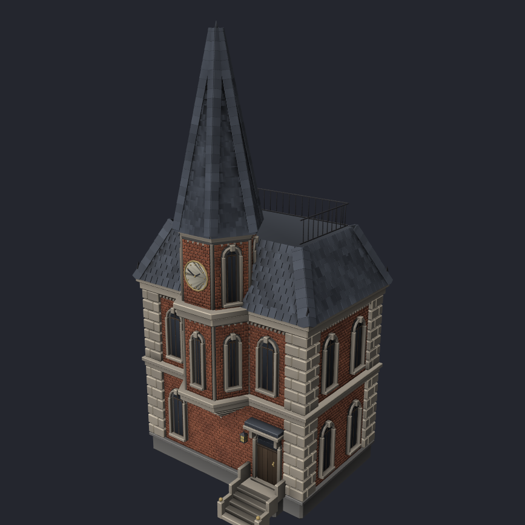 | 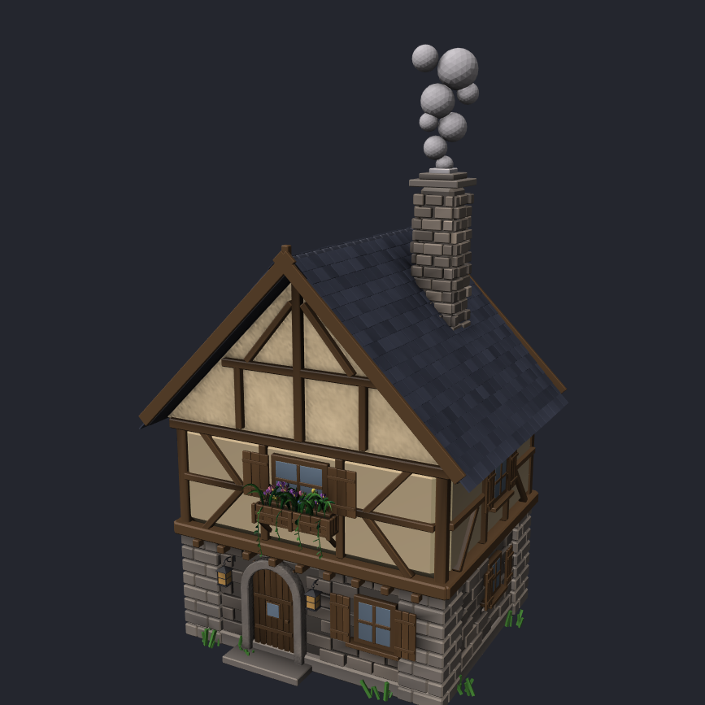 |
| [Inn Hotel](content/pgg/scenes/inn_hotel.pgg) | [Stone Arch](content/pgg/AmberEstate/stone_arch.pgg) |
| 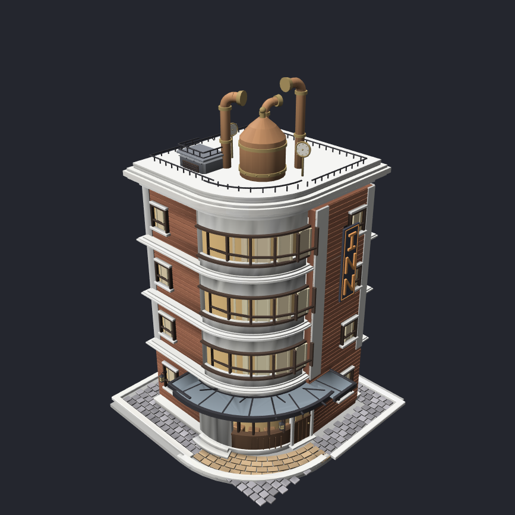 | 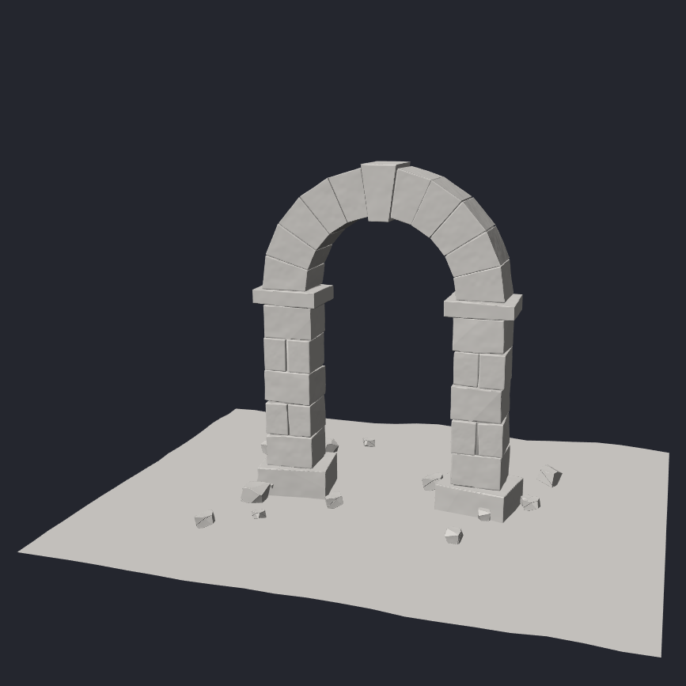 |

How the shots were framed and how to regenerate them: [`docs/gallery/README.md`](docs/gallery/README.md).

## DungeonGeometryGenerator

**DungeonGeometryGenerator** turns a compact project file into a full 3D dungeon. The input is
the *passage graph* (rooms, corridors, and which door connects what) plus room *templates* —
fixed room shapes are optional; the 2D layout itself is solved per seed by
**dungeon_topology_generator** (the Edgar-DotNet port, level-synth). The solved plan is then
filled with geometry built by PGG slot assets (`content/dgg/assets/`: walls, doors, decor, patterns),
checked, and exported to OBJ. Docs:
[`docs/dungeon_geometry_generator`](docs/dungeon_geometry_generator/requirements.md) · demo
projects: [`content/dgg/demo`](content/dgg/demo), [`content/dgg/iso`](content/dgg/iso).

**DGG Viewer** (`src/apps/DungeonGeometryGeneratorViewer`) is the project editor for that
pipeline — not just a preview:

- Start screen with **New** / **Open** and persistent **Recent Projects**; **Files** menu
  (New / Open / Save / Close / Exit), `DGG Viewer - <project>` window title, drag & drop of
  `project.json`.
- Project tree: seed and catalog stats, the passage graph as a single **Layout** row, room
  templates (parametric generators + explicit), fill roles, slots.
- **Layout tab** — node-graph editor of the passage graph: drag rooms to arrange the schema,
  wire doors by dragging from node ports, add/delete rooms and passages, change door types.
  Canvas positions are saved with the project (`layout.editor.node_pos`); the generated
  placement lives in the read-only **Topo** tab, so the user's schema never jumps around.
- **Template cards** — edit roles, transforms, door rules and fill overrides of explicit
  templates and generator size ranges; a contour canvas shows the shape and valid door
  positions.
- **3D / Top / Topo views** — orbit the filled level, inspect the plan overlay (rooms, doors,
  owners, anchors), or compare the solved 2D plan with the passage graph side by side.
- **Async generation** — opening a project only parses it (no UI freeze); Generate /
  Re-layout / Refill run on a worker thread with IDE-style stage timings
  (`catalog → layout → ir → fill`), a progress strip and cooperative **Cancel**. Unchanged
  fill units come back from the F8 cache (a same-seed re-layout is sub-second).
- **Diagnostics** — every run writes `logs/DungeonGeometryGeneratorViewer/run_*.log` and
  snapshots the in-memory project before each generation (enough to reproduce a crash), plus
  a POSIX crash handler that appends a backtrace to the log.

Screenshots below run the isometric demo project [`content/dgg/iso`](content/dgg/iso/README.md)
(10 rooms, no ceilings, wall torches):

| Start screen | Layout tab — passage graph editor |
|---|---|
| 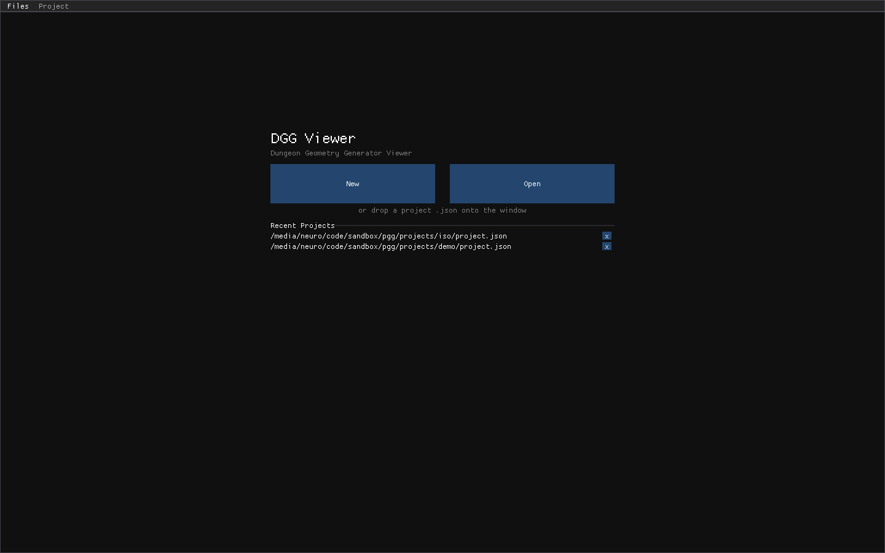 | 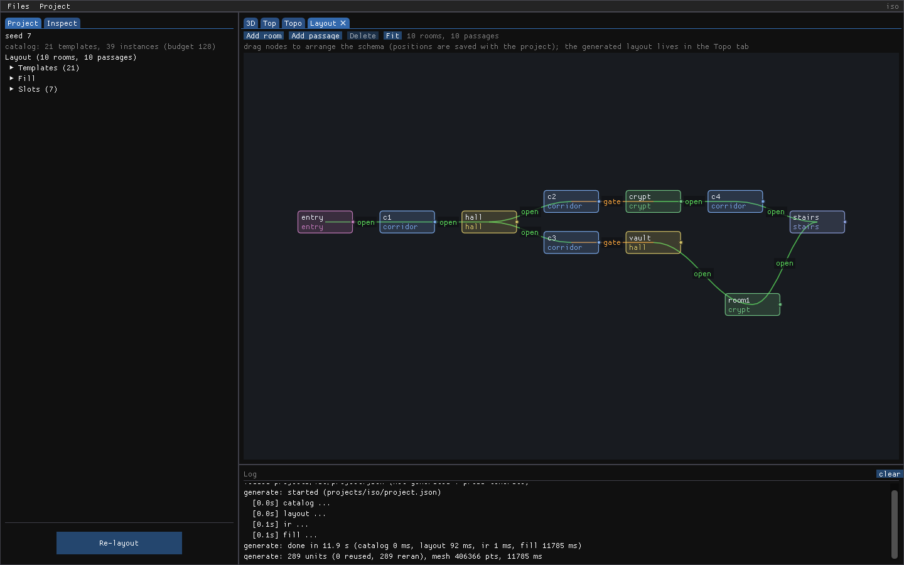 |
| Topo tab — solved plan vs passage graph | Template card — `vault_L` with its L-contour |
| 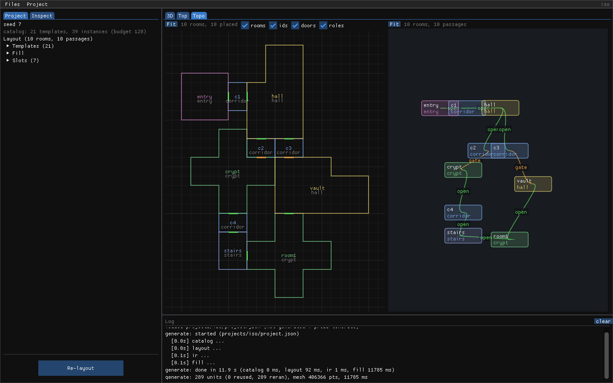 | 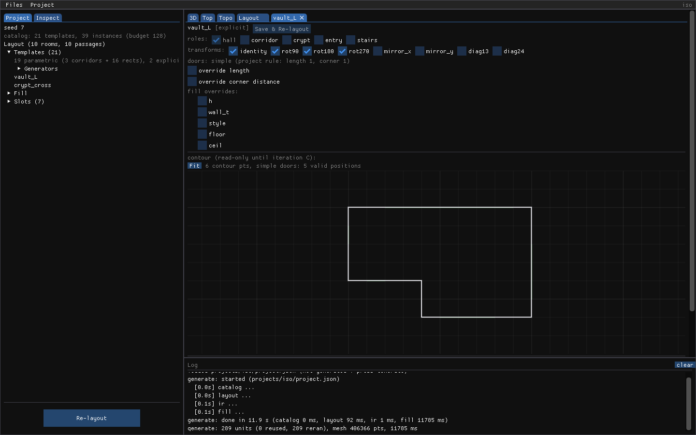 |
| 3D view — the filled dungeon | Top view — plan overlay layers |
| 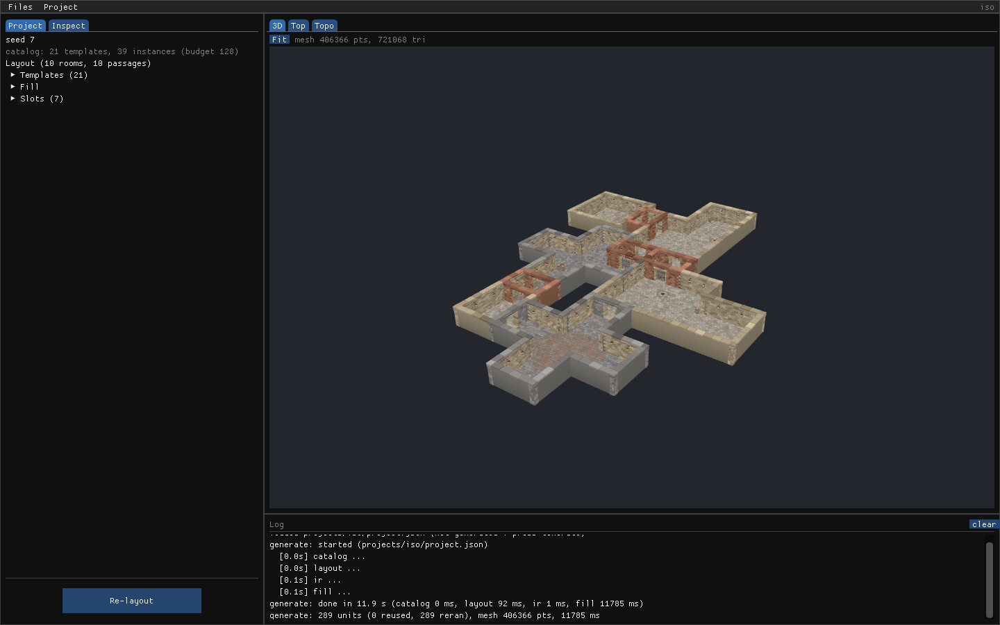 | 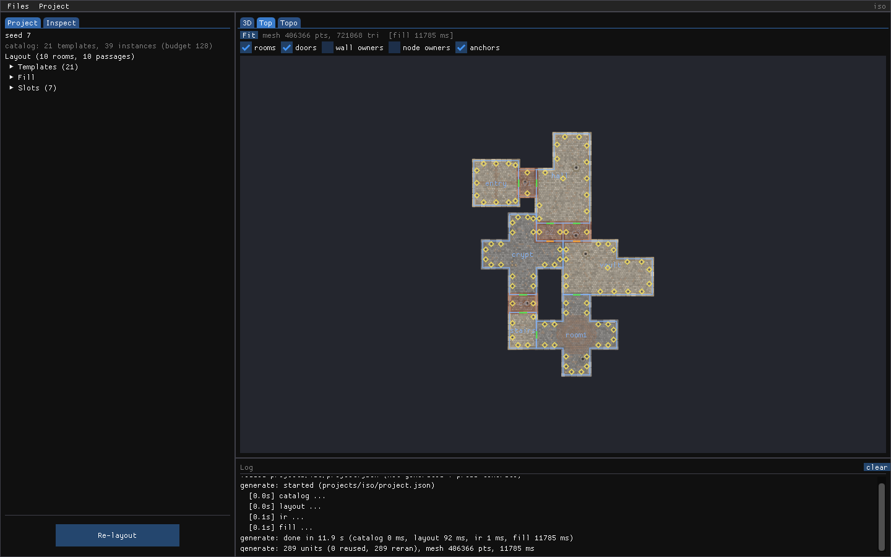 |

Generation runs in the background with stage timings and Cancel; the Log dock narrates:

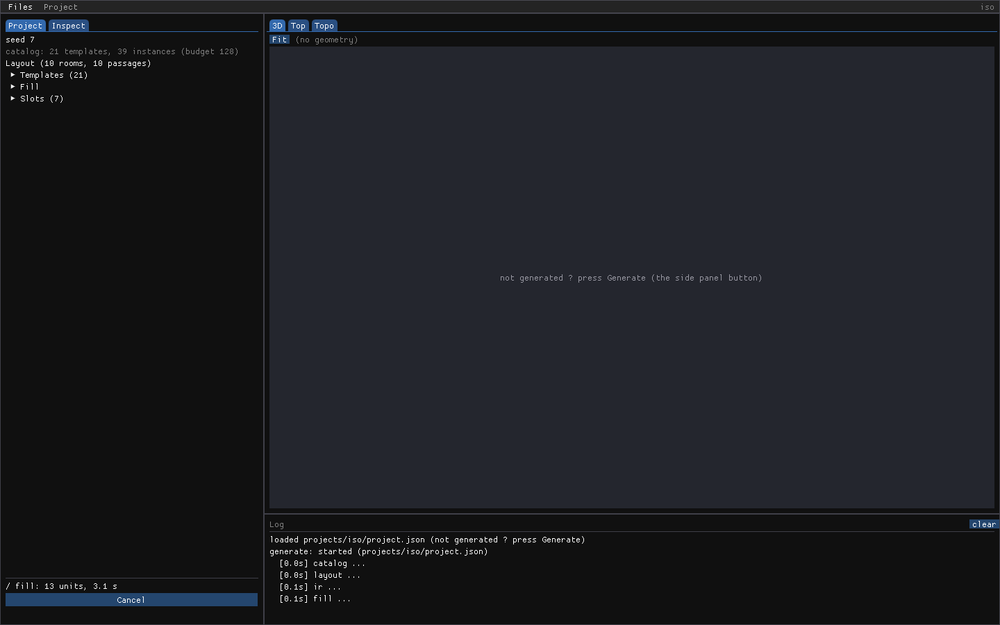

## VillageTopologyGenerator

**village_topology_generator** builds the topology of a small settlement (10–50 buildings,
Stardew Valley / Graveyard Keeper scale): seeded terrain (V1) → relief analysis with a road
cost field (V2) → anchors (V3) → least-cost road skeleton with Y-junctions (V4) → burgage
parcels along the frontages (V5) → constraint-based roster placement (V6). The output is a
versioned Layout IR JSON (`village-topology-generator-layout/0`); building geometry is PGG
(`content/pgg/Village/buildings/`, one asset per type) assembled by **village_geometry_generator**
into a merged world mesh. Docs: [`docs/village_topology_generator`](docs/village_topology_generator/requirements.md).

**VillageTopologyGeneratorViewer** (`src/apps/VillageTopologyGeneratorViewer`, SDL3 + ImGui)
renders the whole pipeline on a pannable map — terrain texture, roads, parcels, building
markers with facade arrows, anchors — with per-stage timings in the log and IR JSON export;
`--smoke` runs headless. **VillageGeometryGeneratorCli** turns an IR file into an OBJ
(`--selftest` runs topology + geometry end to end).

| Path | What it is |
|---|---|
| `src/libs/pgg` | PGG library: parser (ANTLR4 4.13.2), AST, execution core |
| `src/libs/pgg_preview` | Headless preview capture used by dungeon_geometry_generator and tooling |
| `src/libs/dungeon_topology_generator` | Layout generation library (Edgar-DotNet port) |
| `src/libs/drui` | ImGui font/UI helpers for the level-synth viewer |
| `src/libs/dungeon_geometry_generator*` | DungeonGeometryGenerator pipeline: project/IR, layout, fill, check, export, d0 |
| `src/apps/PggTool` | PGG CLI: `check` / `fmt` / `ast` / `run` / `docs` / `diff` |
| `src/apps/PggViewer` | PGG node projection + geometry preview (no TCP) |
| `src/apps/PggServe` | PGG agent RPC daemon: slots by `.pgg` path, `:9878` |
| `src/apps/DungeonGeometryGeneratorViewer` | DungeonGeometryGenerator project editor: passage-graph editor, template cards, 3D/Top/Topo views, async generation |
| `src/apps/DungeonGeometryGeneratorCli` | DungeonGeometryGenerator machine loop: `validate` / `layout` / `fill` / `export` / `check` |
| `src/apps/DungeonGeometryGeneratorServe` | DungeonGeometryGenerator RPC daemon: warm project slots |
| `src/apps/DungeonTopologyGeneratorViewer` | level-synth SDL3 + ImGui viewer |
| `src/libs/village_topology_generator` | Settlement topology pipeline: terrain, analysis, anchors, road skeleton, parcels, placement → Layout IR |
| `src/libs/village_geometry_generator` | Layout IR → PGG building assets → merged world mesh |
| `src/apps/VillageTopologyGeneratorViewer` | Settlement map viewer (SDL3 + ImGui, `--smoke` headless) |
| `src/apps/VillageGeometryGeneratorCli` | Layout IR JSON → OBJ (`--selftest` runs the whole chain) |
| `tests` | gtest suites (`pgg/`, `dungeon_geometry_generator_*`, dungeon_topology_generator), test data (`data/`, `test_data/`), C# parity runner |
| `content/pgg` | PGG content: shared `lib/`, demo `scenes/`, art projects (`AmberEstate/`, `ManorHouse/`, `Mansion/`, `Roads/`), village building assets (`Village/buildings/`) |
| `resources/fonts` | App fonts (Font Awesome), copied next to the viewers by CMake |
| `resources/dungeon_topology_generator_gui` | level-synth viewer data (MapDescriptions, Images, …) |
| `content/dgg` | DungeonGeometryGenerator: slot asset pack (`assets/`) and demo projects (`demo/`, `iso/`) |
| `docs/pgg` | PGG language spec, implementation notes, cheatsheet, RPC contract |
| `docs/dungeon_geometry_generator` | DungeonGeometryGenerator docs (requirements, pipeline, formats, MCP) |
| `docs/level-synth` | level-synth docs (port parity, presets, test matrix) |
| `docs/gallery` | README hero shots of the art examples |

## Build

Build is CMake + vcpkg: submodule `toolchain/vcpkg`, presets in `CMakePresets.json`, overlay `toolchain/vcpkg-overlay/ports`. The first configure bootstraps dependencies from `vcpkg.json`.

```sh
git submodule update --init toolchain/vcpkg
./build_linux.sh                          # cmake --preset linux
cmake --build --preset linux-debug        # everything: pgg, dungeon_geometry_generator, dungeon_topology_generator
ctest --test-dir _int_linux --output-on-failure
```

Windows: `generate_vs.bat` → `_intermediate_64\pgg.sln`, or `cmake --build --preset debug`.
macOS: `./build_mac.sh`, then `cmake --build --preset macos-debug`.

Binaries: `_int_linux/src/apps/<App>/Debug/<App>` (Ninja puts the exe under `$<CONFIG>`).

Platform notes, binary cache, and `compile_commands.json` — `docs/BUILD.md`.

After changing `src/libs/pgg/grammar/Pgg.g4`, run `tools/pgg/regen_parser.sh` (the generated parser is committed under `parser_gen/`).

## Tools

```sh
PggTool check content/pgg/AmberEstate/cottage.pgg
PggTool docs builtins
PggViewer content/pgg/AmberEstate/spire_house.pgg
PggServe                                  # RPC 127.0.0.1:9878
DungeonGeometryGeneratorCli validate content/dgg/demo/project.json
DungeonGeometryGeneratorCli export content/dgg/iso/project.json -o tmp/iso_export
DungeonGeometryGeneratorViewer content/dgg/demo/project.json
DungeonGeometryGeneratorServe                                # RPC daemon, warm project slots
```

MCP servers — `.mcp.json` / `.cursor/mcp.json`: `pgg` (`python3 -m tools.pgg_mcp.launch`) and `dungeon_geometry_generator` (`python3 -m tools.dungeon_geometry_generator_mcp.launch`). Missing binary → `need_build`. Contracts: `docs/pgg/serve_rpc.md`, `docs/dungeon_geometry_generator/mcp_v1.md`. Env: `PGG_REPO_ROOT`, `PGG_SERVE`, `DUNGEON_GEOMETRY_GENERATOR_REPO_ROOT`.

Agent instructions: `AGENTS.md`.
