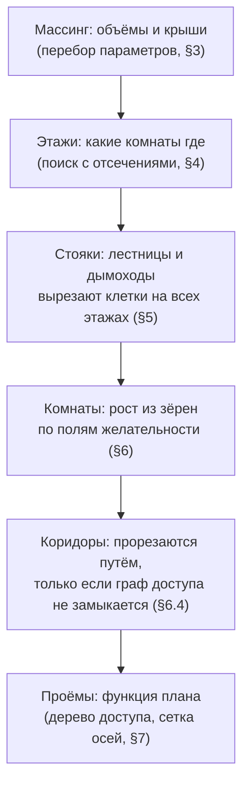

# BuildingGenerator — алгоритмы

**Статус:** черновик v0.3 (2026-10-15) · **Назначение:** как реализовать конвейер и петлю
согласования из `requirements.md` (§6–§9): структуры данных, алгоритмы каждой стадии,
отжиг, каскадный пересчёт, критики, расписание, пример сходимости. Требования и
семантика чисел — в `requirements.md`; здесь — то, как их выполнить.

История правок: **v0.2** — по итогам обзора: сетка этажа и `outline` в переборе массинга
(§1.1, §3), ширина коридора при прорезке (§6.4), «липкие» проёмы (§7), нормировка термов
(§8.4), схема названа ILS (§9), новые тесты (§14). **v0.3** — память проёмов как часть
состояния (§0, §1, §7), маска мансарды до подшивки по худшей точке клетки (§2), подъём
карниза в переборе (§3), ширина прохода по классам стен (§6.4), слуховые окна в цикле
(§7.2), режим прямоугольников B2 (§8.1), параметры второго отжига (§8.2, §11), прыжки
уклона в L4 (§9.3), пример §13 пересчитан.

---

## 0. Обзор: как делится пространство и как сводится

Пространство делится **сверху вниз**, и на каждом уровне фиксируется то, что дороже всего
менять потом:



Сводится **итеративно**: одна функция стоимости смотрит на весь результат (интерьер и
экстерьер), отжиг двигает решение мелкими ходами, а редкие крупные ходы (стояк, этаж,
массинг) перестраивают зависимые уровни через тёплый старт (§9). Критики (§10)
превращают конкретные нарушения в направленные ходы. Интерьер «просит» экстерьер через
критиков; экстерьер «давит» на интерьер через термы стоимости (оси фасада, высота трубы,
полезная мансарда).

Главный приём, который делает это реализуемым: **проёмы и крыша — производные**. В
основном цикле состояние — это массинг, стояки и разметка клеток; крыша, мансарда и граф
доступа пересчитываются из них детерминированными функциями, двери, окна и слуховые
окна — тоже, но с памятью прежних положений (§7), чтобы мелкий ход не переставлял их
скачком. Ходов по проёмам в цикле нет, поэтому пространство поиска остаётся маленьким, а
связь интерьера и экстерьера — точной.

---

## 1. Структуры данных и инкрементальная стоимость

### 1.1. Состояние

```text
State
  massing      объёмы: контуры в клетках (прямоугольник или Г), этажность, крыша (вид, уклоны по рёбрам, подъём карниза, свес)
  storeys[k]   W×H сетка int16: space_id ≥ 0 | OUTSIDE | VOID | CORE(id) | ROOF_VOID
  spaces[]     id, этаж, функция, зона, target_area, min_dim, флаги (habitable, hearth, fixed)
  cores[]      лестницы: тип, позиция, ориентация, отражение; дымоходы: клетки, группа очагов
  memo         запомненные положения дверей, окон, слуховых окон (§7)
  agg          кэши (§1.2), помеченные dirty по этажам/комнатам
  derived      крыша, маска мансарды, граф доступа, двери, окна — пересчёт по dirty (проёмы — с учётом memo)
```

Сетка этажа одна на всё здание: `W×H` — bbox всех объёмов этого этажа в клетках; клетки
вне объёмов — `OUTSIDE` (требования §5.1). Метки: `OUTSIDE` — улица; `VOID` — проём
перекрытия над маршем; `CORE(id)` — клетка стояка; `ROOF_VOID` — закрытый объём мансарды
за кнеевой стенкой (требования §5.6, §6).

### 1.2. Кэши для дешёвой дельты

Ход L0 меняет 1–N клеток; стоимость должна пересчитываться за O(изменения), а не за
O(здание). Для каждой комнаты держатся:

- **площадь** — число клеток;
- **рамка** (bbox) — для терма пролёта и пропорций; пересчёт при изменении крайней клетки;
- **матрица смежности** `adj[a][b]` — число общих рёбер сетки между пространствами
  (`b = OUTSIDE` — длина наружной стены). Передача клетки `c` от `a` к `b`: для каждого из
  4 соседей `n` с меткой `l` снять ребро `(a, l)`, если `l ≠ a`, и добавить `(b, l)`, если
  `l ≠ b`. O(4);
- **число углов** контура — мера формы вместо выпуклой оболочки. Для прямолинейной области
  число вершин = сумма по узлам сетки: окно 2×2 с 1 или 3 клетками области даёт 1 вершину,
  с 2 клетками по диагонали — 2, иначе 0. Клетка влияет на 4 узла → дельта за O(1) для обеих
  комнат.

Проверка связности при отъёме клетки — **локальный тест простой точки**: обойти 8 соседей
`c` по кругу и выделить серии подряд идущих клеток комнаты. Если ровно одна серия содержит
4-соседа `c`, удаление не разрывает комнату (любой путь через `c` обходится по кольцу).
Иначе — BFS по комнате (≤ ~100 клеток). Тест покрывает подавляющее большинство ходов.

### 1.3. Термы с грязными флагами

Каждый терм §8.2 требований разложен на вклад комнат, этажей или фасадов. Ход помечает
затронутое; при оценке пересчитываются только грязные части:

| Терм | Единица пересчёта | Цена |
|---|---|---|
| площадь, форма, пролёт | комната | O(1) из кэшей |
| смежность, коммуникации | пара комнат / этаж | O(1) из `adj` |
| доступность, приватность | весь граф (≤ 30 вершин) | O(V + E), только если менялась смежность или стояк |
| свет, регулярность фасада | фасад × этаж | O(окна) |
| опирание | этаж и соседний | O(рёбра стен этажа) |
| дымоход, высота трубы, крыша | здание | только при ходах L2/L4 |

### 1.4. Откат вместо копирования

Ход записывает журнал изменений (клетки и старые метки, старые значения кэшей, изменённые
записи `memo`) и умеет откатиться. Копия состояния снимается только перед L4 (дорого и редко) и при обновлении
лучшего решения.

### 1.5. Проверка кэшей

Режим отладки (`BTG_VERIFY=1` и в тестах): каждые N ходов полный пересчёт всех кэшей и
стоимости с нуля и сравнение с инкрементальными. Расхождение — падение теста с номером
хода и seed'ом. Без этого инкрементальная стоимость неизбежно разъедется.

Полный пересчёт проёмов получает `memo` на вход: «с нуля» значит «все этажи, а не только
грязные», а не «без памяти». Чтобы сверка сходилась, вывод проёмов обязан быть
идемпотентным: `derive(plan, derive(plan, memo)) = derive(plan, memo)` — на чистом этаже
пересчёт возвращает `memo` без изменений (тест §14).

---

## 2. Крыша и мансарда как функции

Все величины считаются из `StraightSkeleton` (общий модуль, `requirements.md` §11.4).

- **Высота крыши в точке плана** `roof_y(p)`: найти грань скелета, содержащую `p`
  (точка в многоугольнике по граням, их ≤ ~20), и взять высоту её плоскости. Для свеса —
  та же плоскость. Скелет строится с базой `y0 = eave_y − overhang · tan(pitch)`: ядро
  ведёт развёртку со смещённого на свес контура, а плоскость обязана проходить через
  `outline` на `eave_y` (требования §5.6, §7.2).
- **Высота под подшивкой** `h(p) = roof_y(p) − roof_t / cos(pitch(p)) − y_attic`
  (требования §5.6): `roof_y` — верх кровли, `pitch(p)` — уклон грани над `p`.
- **Маска мансарды** на клетках последнего этажа: `h(c) = min h(p)` по углам клетки и по
  точкам пересечения её границы с ендовами (внутри грани `h` линейна, минимум по клетке —
  на этих точках); `walk(c) = h(c) ≥ h_walk`, `knee(c) = h(c) ≥ h_knee`. Клетки
  мансарды — `knee`; остальное — `ROOF_VOID`. Площадь комнаты мансарды считается по
  `walk`-клеткам; пороги, двери и площадка лестницы обязаны лежать в `walk`.
- Маска квантуется клетками: на двускатной крыше полезная ширина меняется шагом `2s`,
  поэтому зависимость площади мансарды от уклона и подъёма карниза ступенчатая (§9.3).
- **Коньки, ендовы, вальмы** — классификация дуг скелета: конёк — горизонтальная дуга
  (`t` концов равны) между гранями противоположных рёбер; ендова — дуга из вогнутой
  вершины контура; вальма — из выпуклой.
- **Правило трубы** (СП 7.13130): `d` — расстояние в плане от центра стояка до ближайшего
  конька, `H_r` — его отметка.

```text
h_req(d) = H_r + 0.5                    при d ≤ 1.5
         = H_r                          при 1.5 < d ≤ 3.0
         = H_r − d · tan(10°)           при d > 3.0
top      = max(h_req(d), roof_y(p) + h_above_roof)
excess   = top − roof_y(p) − h_above_roof        → терм «высота трубы»
```

- **Ендова у трубы**: расстояние от следа стояка до проекций дуг-ендов и вальм ≥
  `valley_margin`, иначе жёсткое нарушение.
- Аналитические формулы для прямоугольника (gable/hip) остаются только эталоном в тестах.

---

## 3. Массинг: перебор кандидатов

Параметров немного, а оценка кандидата дешёвая, поэтому — полный перебор по сетке
параметров с отсечениями, без оптимизации.

```text
for W in [W_min .. W_max] клеток (вдоль фасада), D in [D_min .. D_max]:
  if outline(W, D) + overhang не в участке: continue   # outline = (W·s + t_ext) × (D·s + t_ext): внешняя грань стен, требования §5.2
  if W/D вне пропорций стиля: continue
  for storeys in [s_min .. s_max], attic in {no, yes}:
    for pitch in pitches(style), eave_rise in {0, 0.4, 0.8, 1.2}:   # только при attic = yes
      cand = rect(W, D, storeys, attic, pitch, eave_rise)
      score(cand)
keep top K_rect; for each: try wings / annex (Г — один объём с Г-контуром; пристройка — второй объём,
                                         отсечение по высоте крыши у стены корпуса, требования §7.2) → score
return top M diverse
```

`pitches(style)` — детерминированная дискретизация диапазона стиля `pitch: [min, max]`
(требования §4.1): от `min` до `max` с шагом 5°, всего ≤ 5 значений.

**Оценка кандидата:**

1. Полезная площадь каждого этажа: брутто − стены (периметр × половина толщины наружной +
   оценка перегородок `κ · брутто`) − стояки (оценка: лестница на этаж с лестницей,
   0.25 м² на канал дымохода); у мансарды — по `walk`-маске (§2).
2. Требуемая площадь: сумма целей комнат + доля коммуникаций. Распределение по этажам —
   быстрая версия §4 (жадно, без отсечений).
3. `score = w_fit · Σ_k deficit_k² + w_waste · Σ_k surplus_k + w_compact · P/√A + w_roof ·
   (ендовы, высота конька) + w_prop · (пропорции фасада) − w_opt · (влезшие опциональные)`.
   Нехватка штрафуется квадратично, избыток — линейно и слабее.

**Разнообразие топ-M:** кандидаты сравниваются по ключу (этажность, мансарда, форма);
из одного ключа берётся не больше двух. Иначе все `M` будут вариантами одного и того же
прямоугольника ± клетка.

Сложность: ~20 × 20 × 3 × 2 × 5 × 4 ≈ 5·10⁴ прямоугольников с O(1)-оценкой (маска мансарды
у прямоугольника — аналитически, скелет — только для топ-K и крыльев). Миллисекунды.

---

## 4. Распределение по этажам: поиск с отсечениями

Комнат ≤ 14, этажей ≤ 4, и у большинства комнат один допустимый этаж — поэтому точный
поиск в глубину (по образцу V6 деревни: «самый ограниченный — первым»).

```text
order = rooms sorted by (число допустимых этажей ↑, target_area ↓, id)
dfs(i, partial):
  if lower_bound(partial) ≥ best: return            # отсечение
  if i == len(order): best = cost(partial); return
  for k in allowed_storeys(order[i]) in fixed order:
    if violates(partial + (order[i] → k)): continue  # same_storey, зоны
    dfs(i + 1, partial + (order[i] → k))
```

**Стоимость:** дисбаланс «требуемая / полезная» по этажам (квадратичный по нехватке),
нарушение зон (`private` на первом этаже, `public` наверху — мягко), разорванные `near`
(связь между этажами не считается смежностью), **инерция** — отличие от предыдущего
распределения при каскадном пересчёте (§9). Нижняя граница: сумма нехваток уже
переполненных этажей.

Опциональные комнаты и экземпляры `count` добавляются после: жадно, пока у какого-то
этажа запас площади ≥ цели комнаты × (1 + доля коммуникаций).

---

## 5. Стояки: генерация и отбор кандидатов

Комнат ещё нет, поэтому стояки оцениваются по быстрым признакам. Окончательно их место
решает отжиг (ходы L2).

### 5.1. Лестница

```text
for type in {straight, L, ladder}:                 # ladder — только в нежилую мансарду
  footprint = stair_footprint(type, H_k, params)   # §5.5 требований: n, r, g → клетки марша, площадки, проёма
  for dir in {+X, −X, +Z, −Z}, mirror in {no, yes}:
    for pos in клетки этажа k:
      place = footprint at pos
      hard: марш и площадка внизу — в клетках этажа k; проём и площадка вверху — в клетках k+1;
            если k+1 — мансарда: площадка и выход в walk-маске
            не пересекает уже выбранные стояки
      quick score
keep top K_s
```

**Быстрая оценка:** расстояние низа марша до входной двери (лестница из входной зоны),
прилегание длинной стороной к стене (стремянка и марш у стены дешевле), **фрагментация**:
после выреза стояка — компоненты связности свободных клеток каждого этажа; штраф за
компоненты меньше самой маленькой комнаты этажа. Для 3+ этажей — бонус за стопку (тот же
`pos` для следующей пары этажей).

### 5.2. Дымоход

1. **Группировка очагов.** Очаги одного этажа, комнаты которых могут быть смежны (связь
   `near` или обе `public`), — кандидаты в одну группу «спина к спине»; очаги разных этажей —
   в одну группу «друг над другом». Перебор разбиений на группы (очагов ≤ 4 — тривиально),
   терм «число стояков» за каждую группу.
2. **Позиции для группы по архетипу:**
   - `central` — клетки полосы `|z − z_ridge| ≤ 1.5 м`, внутри контура, не у наружной стены;
   - `gable` — клетки у фронтонных стен (внутри или пристроенные снаружи);
   - `free` — клетки у любой линии, где может пройти стена.
3. **Оценка:** `excess` трубы (§2), симметрия (парные торцевые трубы при `strict`), конфликт с
   лестницей (пересечение — жёстко; соседство — допустимо: так устроен дом со входом в
   тамбур у трубы), ендовы.

### 5.3. Комбинации

Произведение топ-K лестниц × топ-K дымоходов → отсев пересечений → быстрая оценка → топ
`K_c` комбинаций. Каждая — отдельный старт для §6. Вместе с топ-M массингов это и есть
мультистарт.

Стояк фиксирует ограничения для роста комнат: **комнаты очагов обязаны примыкать к своему
стояку** (жёсткий терм «дымоход»), комната низа марша — `public`/коридор, площадка
верхнего этажа — коридор или площадка.

---

## 6. Разбиение этажа: рост с ограничениями

Инициализация по Lopes et al. 2010 с добавленными полями желательности. Все этажи
инициализируются **снизу вверх**: верхний этаж видит готовый нижний (для опирания стен).

### 6.1. Поле желательности зерна

Для комнаты `r` на свободной клетке `c`:

```text
F_r(c) = + a_ext   · [r habitable] · (c у наружной стены)
         + a_ent   · [r ∈ entrance.into] · (близость к центру главного фасада, +Z)
         + a_core  · [r — комната очага] · (c примыкает к своему стояку)
         + a_stair · [r — низ/верх марша] · (c примыкает к низу марша / площадке)
         − a_priv  · [r private] · близость к входу (BFS-расстояние в клетках)
         + a_near  · Σ близость к уже поставленным зёрнам связанных комнат
         + a_stack · [этаж > 0] · совпадение с центром комнаты снизу похожей площади
         − a_crowd · близость к уже поставленным зёрнам (разнос)
```

Порядок постановки: комнаты очагов → входная → комнаты концов лестниц → остальные по
убыванию площади. Зерно — `argmax F_r` с малым шумом PRNG (разнообразие стартов).
Ограничения жёсткие (очаг у стояка) превращаются в маску допустимых клеток, а не только
в вес.

### 6.2. Рост

```text
active = all rooms
phase RECT:
  while active:
    r = pick(active, weight = deficit(r) / target(r))     # отстающие растут чаще
    side = best side ∈ {N, S, E, W}, где вся полоса вдоль стороны свободна,
           area + len(полоса) ≤ max(r), пропорции в пределах; ранжирование сторон:
           наружная стена для habitable, к связанным комнатам, к своему стояку
    if side: присоединить полосу else active −= r
phase L:
  то же, но полоса может быть частичной: самый длинный свободный отрезок вдоль стороны
  длиной ≥ min_dim(r); только пока area < target(r)
phase FILL:
  каждую свободную клетку — соседней комнате с наибольшим дефицитом (при равенстве — меньший id);
  остров свободных клеток ≥ площади коридора без соседей-дефицитных — кандидат в коридор
```

### 6.3. Верхние этажи

Перед ростом этажа `k+1` поле `F` получает бонус за клетки, где рост вдоль линии стены
этажа `k` даст опирание: при выборе стороны предпочитается остановка на линии, под которой
есть стена. Так перегородки начинают стоять друг над другом ещё до отжига.

### 6.4. Коридоры — прорезка

После FILL строится граф доступа (§7.1). Если комната недостижима (или достижима только
сквозь запрещённые комнаты):

```text
src = граница недостижимой комнаты
dst = клетки достижимых public/коридоров
маска: клетка допустима как ось коридора, только если через неё укладывается полоса
       ширины corridor_cells перпендикулярно ходу — иначе коридор не расширить до нормы;
       клетки стояков, VOID — непроходимы
path = A* по маске: цена клетки = 1 + β · (у комнаты нет избытка площади)
       + γ · (клетка не у стены)
ось пути расширяется до ширины corridor_cells в сторону клеток с меньшей ценой
  (комната с избытком площади); расширение невозможно — путь отвергается, узкое
  место исключается из маски, A* повторяется
клетки пути → новое пространство «коридор» (или слить с соседним коридором/холлом)
```

Коридор ведёт вдоль стен и отнимает площадь у комнат с избытком — поэтому он «появляется,
только когда нужен» и не режет комнаты пополам без нужды. Ширина гарантируется маской и
расширением, а не проверкой после факта.

**`corridor_cells`** считается для каждой клетки пути по формуле требований §5.2:
`ceil((w_pass + t_a/2 + t_b/2) / s)`, где `t_a`, `t_b` — толщины стен по бокам полосы по
**прогнозу класса**: сосед `OUTSIDE` — наружная; на той же линии сетки этажом выше или ниже
уже есть стена — несущая; иначе перегородка. С умолчаниями это 2 клетки между
перегородками и 3 у наружной или несущей стены. Прогноз может устареть (на соседнем
этаже позже встанет стена, и перегородка станет несущей), поэтому I3 остаётся жёстким
термом «проходимость» по фактическим классам; построение лишь делает нарушение редким.
Та же формула задаёт ширину марша в клетках (§5.1).

---

## 7. Проёмы как производная плана

В основном цикле ходов по дверям и окнам нет: они пересчитываются из плана (по грязным
этажам). Отдельная доводка ходами L1 — только в финальной полировке (§11).

Чтобы пересчёт не делал ландшафт стоимости рваным (мелкий ход L0 переставил дверь на
другой угол — скачок термов приватности и регулярности), проёмы **«липнут» к прежним
положениям**: при пересчёте этажа дверь, окно или слуховое окно сохраняет положение из
`memo`, пока оно допустимо (отрезок стены не исчез, ограничения §7.1 п. 6 выполняются);
с нуля пересчитываются только новые и ставшие недопустимыми проёмы, и их положения
записываются в `memo`. Поэтому проёмы — не чистая функция плана: `memo` — часть
состояния (§1.1), она пишется в журнал отката (§1.4) и подаётся на вход полной сверке
(§1.5). Полный сброс `memo` этажа — по запросу критика «ось». Стабильность и
идемпотентность проверяются тестами (§14).

### 7.1. Двери: дерево кратчайших путей с ценой прохода

1. **Кандидаты.** Для каждой пары смежных пространств одного этажа — самый длинный
   непрерывный общий отрезок стены; кандидат, если длина ≥ ширина двери + 2 × отступ от узла.
   Связи `no_door` — не кандидаты.
2. **Фиксированные рёбра:** входная дверь (улица ↔ пространство из `entrance.into` с выходом
   на главный фасад), лестницы (низ марша ↔ площадка), связи `door`.
3. **Цена прохода** сквозь пространство `a` по пути к другому:
   `pass(a) = 0` для коридора и холла, малая для `public`, большая для `service`, очень
   большая для `private`. Ребро `a → b` стоит `1 + pass(a)`.
4. **Дерево кратчайших путей (Дейкстра)** от улицы по этим ценам. Спальни выходят
   листьями (сквозь них ходить дорого), кухня — тупиком у зала. Недостижимая комната —
   нарушение «доступность» → критик и прорезка коридора (§6.4).
5. **Одна петля:** добавить не больше одной двери между двумя `public`, если она сокращает
   глубину какой-то комнаты на ≥ 2.
6. **Место двери** на отрезке — минимум суммы расстояний до ближайших углов в обеих
   комнатах (правило Alexander/Merrell), исключая: клетки перед первой и после последней
   ступени, зону стояка, позиции, где полотно перекрывает другую дверь. Привязка к клеткам.

### 7.2. Окна: сетка фасадных осей

1. **Сетка осей фасада** (на фасад, общая для всех этажей): `n = round(L / bay_target)`,
   оси в серединах пролётов `L / n`. При `strict` — симметрично относительно центра фасада;
   входная дверь первого этажа занимает центральную ось.
2. **Слоты комнаты:** оси, попадающие в отрезок её наружной стены с запасом ≥ половина
   окна + минимальный простенок от перегородок.
3. **Сколько окон:** `ceil(area · glass_ratio / window_area(type))`, тип — по функции.
4. **Выбор:** сначала оси, занятые окнами этажом ниже (вертикальное выравнивание), затем
   центральные слоты комнаты, затем симметричные пары при `strict`. Нет слота — окно по
   центру отрезка вне оси (штраф регулярности). Это место, где интерьер влияет на фасад;
   обратное влияние — терм «перегородка на оси окна» тянет перегородки к простенкам.
5. **Крыши других объёмов:** прямоугольник окна проверяется против их плоскостей:
   низ окна ≥ `roof_y` у стены + зазор. Иначе меньший тип или без окна (C13).
6. **Мансарда:** окна во фронтонных стенах по тем же осям торца. `habitable`-комната без
   фронтонного слота получает **слуховое окно** — тоже производное: на скате над
   комнатой, по оси главного фасада, попадающей в её отрезок (иначе по оси комнаты), если
   место допустимо — не ближе зазора к стояку, ребру и ендове, верх слухового окна ниже
   конька. Терм «свет» его засчитывает, терм «крыша» платит за каждое. Нет допустимого
   места — нарушение «свет», критик «тёмная комната». После цикла G7 только уточняет
   геометрию (requirements.md §7.7).

---

## 8. Отжиг

### 8.1. Ходы L0

| Ход | Доля | Описание | Проверки |
|---|---|---|---|
| передача клетки | 0.40 | случайная граничная клетка комнаты (комната выбирается с весом `|дефицит| + 1`) уходит соседу | простая точка (§1.2), `area ≥ min`, клетка не закреплена стояком или очагом |
| сдвиг стены | 0.40 | максимальный прямой отрезок стены между `a` и `b` сдвигается на клетку: вся полоса переходит победителю | BFS-связность проигравшего; прямоугольность сохраняется, только если отрезок — целая сторона обеих комнат |
| обмен комнат | 0.15 | две комнаты одного этажа с близкими площадями меняются метками | ограничения очагов и концов лестниц |
| слить/разделить | 0.05 | опциональная комната сливается с соседом; переросшая комната режется прямой на две, вторая — экземпляр `count` | лимиты программы |

Сдвиг стены важнее передачи клетки: одиночные клетки дают «зубцы», которые терм формы
потом медленно чинит; сдвиг двигает решение крупно.

**Режим прямоугольников (B2, требования §18 п. 2).** Передача клетки и слияние/разделение
выключены (доли — 0 / 0.80 / 0.20 / 0). Сдвиг стены двигает не отрезок между двумя
комнатами, а **линию**: максимальный коллинеарный отрезок стен на одной линии сетки
между концами-тройниками со всеми комнатами по обе стороны. Ход допустим, только если
все эти комнаты остаются прямоугольниками и не меньше `min_dim`. Так разбиение этажа
остаётся набором прямоугольников при любом принятом ходе, а не только в среднем.

### 8.2. Приём хода

Метрополис: принять, если `Δ ≤ 0` или `u < exp(−Δ / T)`, `u` — из PRNG.

- **Калибровка `T0`:** 200 пробных ходов L0 от начального состояния (применить, оценить,
  откатить); `T0 = −mean(Δ⁺) / ln(0.5)` — подъём средней величины принимается с
  вероятностью 0.5.
- **Расписание:** геометрическое `T ← α · T`, `α` такое, что к концу бюджета `T = 0.01 · T0`.
  При застое (нет улучшения лучшего за `N_stall` ходов) — подогрев до `0.3 · T0` один раз.
- **Жёсткие термы — штраф с ростом веса:** `w_hard = w0 · 10^phase`, фазы 0, 1, 2 по трети
  бюджета. В начале поиск проходит через недопустимые состояния, к концу они фактически
  запрещены.
- **Лучшее решение:** снимок при улучшении `(hard_violations, soft_cost)` лексикографически.
  Сравнивается именно мягкая часть: полная стоимость содержит `w_hard` текущей фазы, и
  снимки разных фаз по ней несравнимы.

### 8.3. Выбор уровня хода

Вероятности по умолчанию: L0 — 0.85, L2 — 0.12, L3 — 0.02, L4 — 0.01. С вероятностью
`q = 0.3` ход берётся у критика (§10), иначе случайный. Ходы L2–L4 проходят каскад (§9)
перед приёмом.

### 8.4. Нормировка термов

Все мягкие термы приводятся к безразмерной шкале до взвешивания (требования §8.2):
иначе веса стиля не переносятся между зданиями разного размера — дефицит площади
квадратичен в метрах, а счётные термы нет. Референсы:

| Терм | Безразмерная форма |
|---|---|
| площадь | по комнате: `(deficit / target)² + 0.3 · surplus_frac`; сумма по комнатам |
| форма | по комнате: `max(0, corners − 4) / 4`; ослаблено для коридоров и лестниц |
| смежность | доля невыполненных связей `near` |
| приватность | по private-комнате: `max(0, d_min − depth) / d_min` |
| коммуникации | `max(0, share − share_max) / share_max`, `share` — доля коридоров в площади этажа |
| свет | доля habitable-комнат без окна + недобор остекления в долях `glass_ratio` |
| регулярность фасада | доля окон вне осей + смещение окон от осей в долях пролёта + асимметрия в долях ширины фасада |
| опирание | доля длины стен верхнего этажа без опоры + превышение пролёта в долях `span_max` |
| высота трубы | `excess / H_ridge` (§2) |
| число стояков | `(stacks − 1) / hearths` |
| крыша | `(ендовы + слуховые окна) / число рёбер контура` |
| компактность | `P / P_square` — периметр массинга к периметру квадрата той же площади |

Жёсткие термы счётные (число нарушений) и нормировки не требуют. Веса стиля после
нормировки — порядка единицы.

---

## 9. Каскад и тёплый старт

Крупный ход нельзя оценивать «как есть»: план ещё не подстроился, и ход всегда проиграет.
Поэтому крупный ход = **применить → починить следствия → короткая полировка → принять или
откатить**. Ключевое понятие — **инерция**: при повторном запуске стадии в каскаде к её
стоимости добавляется штраф за отличие от предыдущего решения, чтобы тёплый старт
оставался близким к текущему, а не начинался с нуля.

Строгость отжига при этом теряется: Δ крупного хода смешивает эффект самого хода и итог
полировки, детальный баланс не выполняется. Схема целиком — не имитационный отжиг, а
**iterated local search** с отжигом как внутренним оптимизатором уровней L0–L2. Это
осознанно: калибровка температуры и расписание §8.2 — эвристики, подгоняемые по метрикам
§14, а не гарантии сходимости.

### 9.1. L2 — стояк

```text
apply: новые клетки стояка на всех его этажах
repair:
  клетки, занятые стояком, отнимаются у комнат; распавшаяся комната отдаёт меньший кусок соседу
  освободившиеся клетки — соседней комнате с наибольшим дефицитом
  проверить «очаг у стояка», «концы марша»; нарушено — сдвинуть зерно комнаты к стояку (передачами клеток)
polish: 200 ходов L0 при текущей T, только в радиусе 3 клеток от изменения
accept: Метрополис по полной Δ; отказ — откат журнала
```

### 9.2. L3 — комната на другой этаж

```text
remove(r, k_old): клетки r — соседям с дефицитом (как FILL)
insert(r, k_new):
  зерно = argmax F_r на k_new (§6.1)
  рост с «займом»: r растёт прямоугольником, забирая полосы у соседей
  с избытком площади первыми (займ площади, как в Shadows of Doubt)
polish: 500 ходов L0 по двум этажам
accept: Метрополис
```

### 9.3. L4 — массинг

Снимок всего состояния перед ходом. Варианты хода и тёплый старт:

| Ход | Перенос плана |
|---|---|
| сдвиг ребра объёма наружу | новая полоса клеток на каждом этаже — комнатам, прилегавшим к этому ребру (каждая клетка — соседу изнутри) |
| сдвиг ребра внутрь | полоса удаляется; комната, потерявшая все клетки, вставляется заново (§9.2) |
| уклон или подъём карниза | новое значение — любое из набора (`pitches(style)`, `eave_rise`), не только соседнее: маска квантуется клетками (§2), и соседнее значение может не изменить её вовсе. Пересчёт маски мансарды: выпавшие клетки удаляются, вошедшие — соседям |
| +этаж / −этаж | §4 с инерцией → переселённые комнаты вставляются (§9.2) или новый этаж растёт с нуля (§6) |
| +крыло / пристройка | новые клетки — пустые; §4 с инерцией решает, какие комнаты переезжают; рост на новых клетках с займом |

Затем: стояки, ставшие недопустимыми, переставляются §5 с инерцией (ближайший допустимый
к старому положению); полировка 2000 ходов L0–L2 по всем этажам; приём — Метрополис с
температурой `T · s_L4` (`s_L4 ≈ 5`: дельта крупного хода больше по масштабу). Отказ —
восстановление снимка.

---

## 10. Критики

Интерфейс:

```text
struct Violation { kind; where (комната/этаж/стояк/фасад); weight }
struct Critic {
  detect(State) -> vector<Violation>               # детерминированный порядок
  propose(State, Violation) -> vector<Move>        # отсортированы по ожидаемому выигрышу
}
```

Шаг критика: выбрать нарушение с весом по его вкладу в стоимость, взять одно из трёх
первых предложений (PRNG), провести через каскад и приём. Критик не применяет ход в
обход Метрополиса — он только направляет выбор. Список критиков и их предложения —
`requirements.md` §8.4.

Приоритеты: предложения нижних уровней первыми (дешевле и обратимее). Критик «не влезает»
предлагает L3 и удаление опционального раньше, чем L4. Экстерьер меняется, только когда
интерьер не справляется сам. Для мансарды критик сразу считает маску (§2) для всех
значений уклона и подъёма карниза и предлагает наименьшее изменение, которое закрывает
дефицит, — а не перебирает их случайными ходами.

---

## 11. Расписание целиком

```text
generate(program, plot, params, seed):
  rng   = Rng(seed)
  prog  = load_and_expand(program)                          # G1
  mass  = enumerate_massing(prog, plot)                     # G2 → top M (§3)
  starts = []
  for m in mass:
    assign = assign_storeys(prog, m)                        # G3 (§4)
    for cores in core_combos(prog, m, assign):              # G4 → top K_c (§5)
      S = init_plans(prog, m, assign, cores, rng.split())   # G5: зёрна, рост, коридоры (§6)
      S = anneal(S, levels = {L0, L2}, critics = on, budget = B1)
      starts.push(S)
  pool = top_R(starts, by = (hard, cost))
  best = none
  for S in pool:
    S = anneal(S, levels = {L0..L4}, critics = on, budget = B2,
               T0 = 0.3 · calibrate(S), hard_phase = 2)   # подстройка, а не новый поиск
    best = better(best, S)                                # по (hard, soft_cost)
  best = polish(best)                 # T = 0: жадные L0 + явные L1 (сдвиг дверей и окон)
  place_roof_elements(best)           # G7: выходы труб, уточнение слуховых окон
  return derive_ir(best)              # G8 (§12)

anneal(S, levels, critics, budget, T0 = none, hard_phase = none):
  T = calibrate(S) if T0 is none else T0
  # hard_phase = none — фазы w_hard по третям бюджета (§8.2); число — фаза зафиксирована.
  # Во втором отжиге фаза сразу последняя: иначе нарушения, вычищенные в первом, вернутся.
  for it in 0 .. budget:
    level = sample(levels)
    move  = critic_move(S, level) if critics and rng.u() < q else random_move(S, level)
    Δ     = apply_with_cascade(S, move)       # §9 для L2..L4; журнал для отката
    if Δ ≤ 0 or rng.u() < exp(−Δ / scale(level, T)): keep
    else: undo(S)
    update_best(S); T = cool(T, it)
    if cancelled or time_over: break
  return best
```

Бюджеты по умолчанию: `M = 3`, `K_c = 4`, `R = 4`, `B1 = 20 000` ходов на этаж, `B2 = 50 000`
ходов на здание. Порядок обхода детерминирован; каждый старт получает свой отщеплённый
поток PRNG.

---

## 12. Вывод границ (G8)

- **Стены:** для каждого ребра сетки этажа с разными метками по сторонам (кроме граней
  дымохода и `VOID`) — сегмент; коллинеарные соседние сегменты с одной парой сторон
  сливаются; стена делится в вершинах, где в неё упирается перпендикулярная (семантика
  тройника DGG).
- **Класс:** `exterior` — одна сторона `OUTSIDE`; `gable` — наружная стена мансарды под
  фронтоном; `knee` — граница клетки мансарды с `ROOF_VOID`; `bearing` — наружная или
  совпадающая со стеной этажа выше или ниже; иначе `partition`.
- **Узлы:** вершины, где сходятся ≥ 2 стены или стена меняет направление; владелец —
  наименьший id смежного пространства.
- **Плиты:** клетки пола этажа `k+1` минус `VOID` и клетки дымоходов → жадное разбиение на
  максимальные прямоугольники: обход по строкам, от первой непокрытой клетки — вправо до
  упора, затем вниз, пока строка-отрезок свободна целиком; детерминированно.
- **Ограждения:** рёбра `VOID` со стороны пола.
- **Верх фронтона:** две плоскости ската над стеной (их id из скелета) — PGG режет тело
  стены `clip` по ним.

---

## 13. Пример: как петля сводит дом

Программа §4.1 требований с `bed: count [2, 3], area [10, 14]`. Участок 12 × 14 м,
стиль `central`, `loose`. Числа округлены; клетка 0.5 м.

| Шаг | Что сработало | Ход | Что изменилось |
|---|---|---|---|
| 1 | §3 перебор | — | корпус 8 × 7 м по осям (`outline` 8.45 × 7.45), один этаж + мансарда, уклон 45°, подъём карниза 0.8 м, пирог 0.25 м. Первый этаж (кухня 16, гостиная 14, тамбур 3, кладовая 4, лестница) вмещается: ≈ 50 м² чистой площади при 56 м² по осям |
| 2 | §4 | — | спальни — в мансарду. При 45° высота под подшивкой ≥ 2.0 м — с 1.55 м от внешней грани (1.33 м от оси); по худшей точке клетки полезная зона начинается в 1.5 м от осей наружных стен → полезная ширина 4.0 м × ~7.55 м ≈ 30 м² |
| 3 | §5 | — | дымоход: группа {кухня, гостиная} спина к спине на перегородке `x = 0` в полосе конька; Г-лестница у тамбура рядом со стояком (тамбур перед трубой — классический приём) |
| 4 | §6, отжиг L0 | — | 2 спальни у фронтонов, площадка лестницы в центре — всё допустимо, но терм «полнота программы» недоволен: третья спальня (`count` до 3) не влезает. Нужно 3 × 10 + площадка ~3 + проём ~2 + перегородки ~1.5 ≈ 36.5 м² > 30 |
| 5 | критик «не влезает» | L4: подъём карниза 0.8 → 1.2 м | интерьер меняет экстерьер. Критик считает маску для всех значений (§10): 50° даёт те же 4.0 м (маска квантуется клетками), 55° или подъём карниза до 1.2 м — 5.0 м, ≈ 37.8 м². Подъём карниза дешевле по терму крыши (конёк выше на 0.4 м, а не на 1.6 м). Третья спальня влезает, полная Δ после полировки < 0 — ход принят |
| 6 | вывод проёмов (§7.2 п. 6) | — | средняя спальня (у главного фасада, без фронтона) получает слуховое окно на переднем скате: терм света доволен, терм крыши платит за одно слуховое окно. Снова экстерьер от интерьера |
| 7 | терм регулярности | — | слуховое окно встаёт на центральную ось главного фасада (над входной дверью): она попадает в отрезок спальни (§7.2 п. 6) |
| 8 | терм «перегородка на оси» | L0: сдвиг стен | перегородки средней спальни сдвигаются, чтобы окно встало по центру комнаты: экстерьер меняет интерьер |
| 9 | терм высоты трубы | — | стояк `x = 0` оказывается на перегородке между средней спальней (спереди) и площадкой (сзади) на линии конька; верх трубы = конёк + 0.5 м — минимальный. Перегородка мансарды стоит над перегородкой кухня/гостиная внизу (терм опирания доволен) |

Итог: высота карниза, слуховое окно и его ось, положение перегородок, место трубы и
лестницы определились **совместно**. Ни одно из этих решений не было зафиксировано
раньше остальных.

---

## 14. Производительность и проверка алгоритмов

**Бюджет.** Этаж 8 × 7 м — 224 клетки; ход L0 с дельтой — единицы микросекунд (кэши §1.2,
граф доступа ≤ 30 вершин пересчитывается только при смене смежности). `B1 · стартов + B2 ·
R` ≈ 10⁶ ходов → доли секунды в Release, единицы секунд в Debug — в рамках N2 требований.
Узкие места — L4 (полировка 2000 ходов) и скелет; L4 редки, скелет кэшируется по
(контур, уклоны).

**Юнит-тесты алгоритмов:**

- тест простой точки против BFS на случайных сетках;
- инкрементальные кэши (площадь, `adj`, углы) против полного пересчёта после 10⁴
  случайных ходов;
- инкрементальная Δ против разности полных стоимостей (режим §1.5);
- `roof_y` и маска мансарды против аналитики прямоугольника (gable, hip), с `roof_t` и
  худшей точкой клетки; числа примеров требований §5.6 и шагов 2 и 5 §13 — численный тест;
- правило трубы на трёх зонах `d` и граничных значениях;
- дерево доступа: спальни — листья, `no_door` соблюдён, недостижимое детектируется;
- слоты окон на симметричном фасаде; выравнивание по оси нижнего этажа;
- разбиение плиты на прямоугольники покрывает область ровно один раз;
- каскад L4: после сдвига ребра каждая клетка этажа размечена, комнаты связны;
- коридоры: после прорезки ширина ≥ `corridor_cells` на всём пути, I3 выполняется;
  коридор вдоль наружной стены получает 3 клетки;
- стабильность проёмов: после одного принятого хода L0 не более 10 % дверей и окон
  меняют положение (липкость §7);
- идемпотентность вывода проёмов: повторный вывод на том же плане не меняет `memo`;
  откат хода восстанавливает `memo` побайтно;
- режим прямоугольников B2: после 10⁴ случайных ходов все комнаты — прямоугольники;
- крыша пристройки: кандидат, чья крыша у стены выше `roof_y` корпуса − `apron_gap`,
  отсекается в G2;
- детерминизм: два прогона на одной платформе — одинаковый fingerprint IR (требования N1).

**Метрики качества** (эталонный набор программ × seed'ов, голдены): доля решений без
жёстких нарушений, средняя стоимость по термам, число принятых L3/L4, время. Регресс
стоимости больше порога — красный тест: веса и алгоритмы правятся осознанно, а не на
глаз.

---

## 15. Реализация B2: статус и выбранные решения

Статус: B2 реализован (`src/libs/building_topology_generator/{plan,openings,cost,anneal,emit}.*`,
`rng.h`), приёмка §16 зелёная: 3 программы × 100 seed'ов — I1, I3, I6, I7 = 100 %,
жёстких нарушений нет; ~8–9 тыс. ходов/с (Debug), средний план ~2.3 с при бюджете
20 000. Расхождения и уточнения против §6–§11, которые стоит знать перед B3:

- **Рамка.** План сразу работает в рамке здания (требования §5.1): `grow_floor`
  центрирует контуры кандидата ровно так же, как `massing_to_ir` (минус центр
  union-bbox). План, spaces/walls/nodes и volumes в IR живут в одной рамке;
  отдельного «углового» фрейма нет. (Ранняя версия держала план в угловой рамке —
  это давало смещение эмита относительно volumes.)
- **Поля `origin` в span-координатах.** Вдоль вертикальной стены (x = line)
  пролёт отсчитывается от `origin.y` (z), вдоль горизонтальной — от `origin.x`.
  Перепутанная пара невидима, пока `origin.x == origin.y` (угловая рамка с
  одинаковым отступом), и ломается в центрированной — проверять оба места при
  правках (`place_door` memo и слоты окон).
- **G5.** Зерно: комнаты входа сажаются на свою фасадную строку (front = верхняя
  строка, j = h−1), далее по убыванию target; поле желательности — §6.1. Рост —
  полными сторонами (прямоугольник сохраняется структурно), FILL раздаёт остатки
  безусловно. Ремонт: декомпозиция поля в максимальные прямоугольники + гильотина
  внутри каждого (не «обрезка по outside»). Коридоры (§6.4) выключены — доступ
  чинит отжиг.
- **G6.** Цены прохода: hall/lobby/corridor 0, public 0.5, service 2, private 10.
  `entrance.into` / `back_door.into` — ALLOWED-множества: ровно один хост каждый,
  выбирается по пролёту фасада, ближайшему к центру фасада; уличное ребро в
  Дейкстре только у выбранных хостов. Двери: дерево Дейкстры → door-ссылки
  программы → публичные петли (|Δdepth| ≥ 2). Окна: оси пролётов
  (`bay_target` 2.5 м, clearance = win_w/2 + pier 0.25), fallback — центр самого
  длинного пролёта вне осей (C6 штрафует, I6 выполняется). Липкий memo: двери
  «idA|idB» → (vertical, line, m0), окна «roomId|side» → ось.
- **Стоимость B2.** Hard: доступ, программа (хосты входа/чёрного хода + door-
  ссылки), min_dim. Soft: area, adjacency, privacy, light, regularity, span
  (form ≡ 0 в прямоугольном режиме). Нормировки — §8.4; веса — `PlanParams`.
- **Ходы L0.** Сдвиг линии по «unit'ам»: максимальный интервал линии, где комнаты
  обеих сторон стыкуются ровно в линию (замыкание по полным z/x-диапазонам) —
  инвариант прямоугольного тайлинга сохраняется конструктивно; плюс свободный
  обмен прямоугольников. Передачи/слияний нет (B2).
- **Критики** (30 % ходов): программа (хост входа/чёрного хода меняется с
  комнатой, у которой есть дверь-capable пролёт на нужном фасаде; потерянная
  door-ссылка — обмен b с соседом a), недостижимая комната, тёмная комната,
  окно вне оси.
- **Перезапуски.** Ходы L0 не меняют столбцово-строчную топологию, которую
  породил рост: встречаются тайлинги, где программа невыполнима в принципе
  (door-ссылка через три уложенные в столбец комнаты). Поэтому `plan_floor` при
  hard > 0 перезапускает рост+отжиг из отщеплённого потока PRNG
  (`max_attempts` = 6) и берёт лучший по (hard, soft). Это детерминированно (N1).
- **Эмит (G8).** Стены сливаются по (orientation, line, side pair); owner —
  лексикографически меньшая комната, у наружной — сама комната (I9). Якорь
  входа — только у двери переднего фасада (+0.6 м наружу, dir +Z), даже если та
  же комната хостит и чёрный ход. Очаг — спина-к-спине с очаговым соседом, иначе
  самая длинная внутренняя сторона; bed_slot — 1.0 м от первой наружной стороны.
- **Мягкие пороги приёмки** щедрые (mean < 0.6, p95 < 1.0): у tavern доминируют
  area и regularity (~0.24). Тюнинг весов — по метрикам §14, осознанно.

## 16. Реализация B3: статус и выбранные решения

Статус: B3 реализован (`pipeline.cpp`: `storey_fields` → `place_stairs` (G4) →
`assign_storeys` (G3) → по этажам рост+отжиг (G5) → проёмы (G6) → эмит (G8);
фаза L роста включена — комнаты с крыльями). Приёмка §16 зелёная: 100 seed'ов ×
house (принудительно 2 этажа + мансарда, участок 16×14) — I1, I3, I6, I7 = 100 %,
ни одной заблокированной лестницы; E2E (массинг → план → эмит → PGG fill →
проверки §14) на seed 1–3 зелёный; ~10 тыс. ходов/с (Debug), средний seed ~2.3 с.
Расхождения и уточнения против §3–§11:

- **Поля этажей (storey_fields).** Общая сетка по union-bbox контуров (§5.1);
  клетка мансарды — free при `h ≥ h_knee` по худшему углу, walk при
  `h ≥ h_walk`; за кнеевой линией — `ROOF_VOID`. Walk-маска ограничивает и
  колодец лестницы (§9.1), и площадной учёт мансарды (§5.6).
- **G2: два фильтра мансарды.** Кандидат с мансардой отбрасывается, если (1)
  walk-зона не принимает колодец+прибытие ни одной формы колодца (точный
  перебор §14.2-полос по 8 ориентациям и всем рассечениям маршей —
  `attic_walk_hosts_stair` общий с G4, дрейф исключён) или (2) полезная
  площадь (walk-клетки × (1−κ) − половина лестницы) за вычетом резерва
  циркуляции не вмещает `area_min` наименьшей required-комнаты с допуском
  `attic`. Второй фильтр закрывает границу «мансарда существует, но не держит
  ни одной комнаты»: донор G3 (§7.3) ставил бы туда комнату безусловно, и
  отказ всплывал на G5 как «no free cell». L-кандидаты сканируются как hip
  (скелет Г-контура имеет ендовы), поэтому их walk-полоса центральная и оба
  фильтра кусаются чаще — типовой ответ поиска: двускат с подъёмом карниза.
- **G3.** Net этажа = free-клетки (мансарда: только walk) − шахты уходящих
  лестниц, × (1−κ). Резерв циркуляции `max(3 м², 10 % net)` на этажах со
  лестницей: авто-коридор не отъедает площадь последней допущенной комнаты.
  Донор пустого этажа — с проверкой `area_min` против net−резерв; промах —
  честная ошибка (G2 должен был отсеять), а не западня для G5.
- **G4 (place_stairs).** По ядру на пролёт, снизу вверх; колодец штампуется
  `kCellVoid` в поле верхнего этажа (следующие ядра его видят), шахта —
  pinned-комната нижнего (door_ok только на полной высоте: пэд, ниша рядом с
  маршем 1, ряд прибытия). Скоринг кандидата: дистанция до аттрактора +
  компактность + прижатие к стене + дельта тайлируемости + джиттер ретрая.
  Тонкости, без которых L-футпринты не сходятся:
  - Аттрактор первого ядра — центроид walk-маски мансарды, когда цепочка
    завершается мансардой: колодец верхней лестницы обязан лежать в walk-зоне,
    и база у фасада загоняла бы верхнее ядро в центр этажа, дробя его на
    куски без 5×5-блока под спальню. Дальше аттрактор — шахта нижнего ядра
    (стопка, §9.1 «по умолчанию»).
  - Тайлируемость заряжается дельтой от baseline нетронутого поля: полоса,
    отрезанная собственным вырезом Г-контура, не должна наказывать каждого
    кандидата. Фрагментация мансарды взвешена вдвое.
  - Хард-фильтр dead-pocket: кусок тоньше 2 клеток рядом с шахтой/колодцем,
    не покрываемый 2×2 даже через свободных соседей, отбрасывает кандидата —
    такой карман не станет ни комнатой, ни крылом (I1).
  - Хард-фильтр связности: верхнее поле после выреза колодца обязано остаться
    4-связным (I3).
- **G5.** Посевной фильтр wing-only — точный, по квадратам: клетка пригодна
  для посева комнаты с `min_dim`, если её покрывает хотя бы один свободный
  квадрат с NET-стороной ≥ `min_dim` (маржи — `piece_side_margins`; любой
  feasible-прямоугольник содержит такой квадрат на короткой стороне, поэтому
  тест точен). Оценка по максимальным прямоугольникам декомпозиции занижала
  поле: комната может стоять на нескольких кусках сразу (мансардные полосы
  вокруг колодца). Крылья (фаза L): после гильотины сиротские куски
  крепятся к ФИНАЛЬНЫМ rect'ам комнат сегментацией полосы вдоль длинной оси по
  граничащим комнатам (колонки без комнаты — ближайшему сегменту, коридор —
  последний кандидат); per-сегмент covering test (m от `min_dim` хоста, ярус
  крыла = 2 клетки). Ранняя версия крепила крыло только к single-room кускам и
  теряла полосы между двухкомнатными.
- **Стоимость B3.** +терм support (C11): доля длины перегородок этажа без
  стены прямо под ними (`below` протянут в отжиг; VOID не считается стеной —
  у ограждения нет тела, §5.2). Терм form работает (фаза L):
  `max(0, corners−4)/4`.
- **Мягкие пороги приёмки** откалиброваны по первому зелёному прогону с
  запасом ~25 % (mean 6.6, p95 7.7 на сумме трёх этажей). Доминируют support
  (сырой ~0.97/этаж: последовательный поэтажный отжиг почти не выравнивает
  перегородки верхнего этажа по стенам нижнего — совместная оптимизация этажей
  из §7.5 остаётся делом ревизии метрик §14) и area (мансардная спальня по
  §5.6 считается только по walk-клеткам и структурно недобирает target).
  Требования §16 для B3 нормируют только жёсткие инварианты.

---

## 17. Реализация B4: дымоходы — статус и выбранные решения

Статус: B4 реализован. G4b (`place_chimneys`, `chimneys.cpp`) стоит между G3 и G5
в `pipeline.cpp`: очаги этажа группируются по два (пара «спина к спине» делит
стояк 1×2, §9.2), верхний очаг присоединяется к проходящему стояку («второй
канал», сечение не расширяется — §5.7 и так режет 1×2), остаток получает новый
стояк. Ячейки стояка штампуются `kCellCore` на всех пересекаемых этажах от
земли (кладка поднимается от y=0 — поддержка; «начиная с этажа очага» из §9.2
оставило бы верхний стояк висячим). Архетип из `style.chimney` падает по цепочке
central → gable → free; выход считается при размещении (верх по §5.7 от
`d_to_ridge`, отступ `valley_margin` от ендов и вальм, плоскость выхода содержит
центр сечения; BGG-чек перепроверяет всё численно). Эмит: `Ir::chimneys` +
`hearth`-референсы (стена, s, якорь в 0.9 м от стены); стены «комната|стояк»
не эмитятся — грань строит ассет стояка.

Расхождения и уточнения против §5.2 и §9 — то, чего не хватило для приёмки
100/100 seed'ов (hard=0):

- **Гейты кандидата, per crossed storey.** Поле «как его увидит рост»: шахты
  лестниц штампуются ядром. Дальше: занятость/шахта/ряд прибытия, 4-связность
  без кандидата, `dead_piece_near`, и **re-slice гейт** (`field_reslice_feasible`
  — свободное назначение комнат кускам + рекурсивная гильотинная
  feasibility по net min_dim): стояк, оставляющий этаж без гильотинного
  разбиения, отбрасывается до роста. Порядковые тонкости: мансардная
  `ROOF_VOID` клетка доступна стояку (тело поднимется сквозь неё), ре-slice
  мансарды идёт по walk-полю.
- **Rect-net карты кусков.** `field_piece_net_rect` (net min сторона куска на
  клетку) и `field_piece_ids` (id куска + net-протяжённости + rect) режут поле
  ровно как ремонт G5 (`decompose_field` + `merge_rect_pairs`) — посевной фильтр
  `seed_next_to` и гейты G4b предсказывают привязку ремонта, а не
  «квадратную» достижимость (квадраты завышали: клетка полосы покрывается
  квадратом, вылезающим в соседний кусок).
- **Frontage-гейт пары — seeded-контактная feasibility.** Каждая комната группы
  получает distinct соседнюю клетку стояка (будущий контакт); комнаты, легшие в
  один кусок, обязаны быть seeded-гильотинно-совместимы (`seeded_rect_rec`:
  разрез валиден, только когда pin'ы сторон строго сепарабельны вдоль оси).
  Широкий кусок несёт ОБЕ комнаты пары с одной стороны стояка (канонический
  back-to-back на границе hall|parlour) — ранняя версия правила («≥3
  жизнеспособных стороны, комнаты никогда не делят сторону») отвергала именно
  его, потому что pin-столбцы (1 м друг от друга) режут кусок на полосы, каждая
  из которых обязана вместить min_dim своей комнаты.
- **Коридор-гейт.** Этаж с авто-коридором (шахта стартует, явного коридора
  нет) сеет его у полностью door-ok сторон шахты (`corridor_seed_cells` —
  общий helper G4b и pipeline: длинная сторона марша + дальний торец, §9.1);
  кандидат обязан оставить хотя бы одну такую клетку в куске с net ≥
  `min_dim` коридора. Без гейта стояк, сжавший полосу между собой и шахтой до
  2 клеток (net 0.88 м < 1.0), убивал попытку на посеве коридора.
- **Tried-ban ретраев.** Скоринг стояка доминируется геометрией (высота,
  фрагментация), джиттер rng argmin почти не переворачивает — без бана ретраи
  выбирали ту же позицию (наблюдалось 12 одинаковых подряд). Наборы клеток
  стояков неуспешных попыток (`normalize_stack_cells`) запрещаются следующим;
  дефолт `max_retries` поднят 3 → 16 (выход ровно при hard == 0, лёгкие seed'ы
  не платят).
- **Pin-aware ремонт G5.** Комната, посеянная из never-relaxed `seed_next_to`
  (очаг у стояка, авто-коридор у шахты), несёт `PlanRoom::pin_cell`. Гильотина
  ремонта сортирует и режет по pin'ам (порядок по pin-проекции, span-клампы
  containment, лист обязан содержать pin); pin-first проход перевязывает
  комнату в кусок её pin'а; донорство сирот и joint-фикспоинт не двигают
  pin'овые комнаты (цель для такой комнаты — только кусок pin'а). Без этого
  центроидная привязка отдавала фронтаж стояка комнате без очага (лобби), а
  отжиг не мог вернуть контакт: крылатая/заякоренная комната неподвижна.
- **Якоря в отжиге.** Hearth-комната, касающаяся ядра, — anchored: критики
  entrance/door-link/access/dark-room и swap-ветка random_move её не двигают
  (обе стороны дверного линка anchored — только shift_touching). Иначе ход,
  чинящий один жёсткий терм, ломал hearth-контакт, и лексикографический best
  застревал на hard=1.
- **Soft door-gap градиент (§7.1).** Каждая недостроенная дверь (программный
  линк или уличная) даёт soft-терм `(min_run − лучший_прогон)/min_run`
  (`DerivedOpenings::door_gap`, вес `w_door_gap`): у отжига появляется
  градиент «расширить контакт до двереспособного прогона», а не плато 0/1.
- **Эмит стен: фильтр чужих плоскостей.** В `top_profile` стены попадали ВСЕ
  плоскости крыши L-объёма; плоскость другой ноги L в продолжении клала
  «поверхность крыши» ниже пола, и clip в `bl.wall_body` стирал всё тело
  (empty mesh на коленных стенах мансарды). Плоскость, чья высота ≤ пола на
  ОБОИХ концах пролёта, отбрасывается (по линейности — вдоль всего пролёта).
- **Ось окна хранит линию прогона, не bbox комнаты.** `DerivedOpening::line`
  для окна брался со стороны bbox главного rect'а — у крылатой комнаты
  экстерьерный прогон может лежать на крыле (другая линия), и эмит не находил
  стену-хозяина («no host wall», I7 падал до 70 %). Слот теперь несёт
  (ось, линия прогона-хозяина).
- **Дневной свет — жёсткий терм (I6) на полноэтажных планах.** Центральный
  стояк стягивал жилые очаговые комнаты (hall/parlour) в середину плана без
  фасада; soft-штраф их не двигал (критик тёмных комнат не трогает
  заякоренные/крылатые). Как hard-терм неосвещённая жилая комната гонит
  драйверские ретраи (ban заставляет каждую попытку ставить стояк иначе —
  выигрывают фронтонные позиции, где обе комнаты делят фасад). Мансарда
  освобождена (`OpeningRules::full_height`): у hip-мансарды нет фронтонной
  стены под окно до слуховых (C4), там light остаётся soft-термом.

Приёмка: 100 seed'ов × house (2 этажа + мансарда): hard=0 на всех, I1/I3/I6/I7
и I4/I5 (контакт очага и §5.7-числа) по 100 %, E2E (массинг → план → эмит →
PGG fill → §14) зелёный, включая seed 1–3. Soft-метрики не сдвинуты: mean 6.56,
p95 8.07 (пороги 8.0/10.0); light = 0.000 (тёмных жилых комнат нет нигде).
Узел seed'а 1 (стояк (8,11) резал единственный дверной прогон lobby~parlour)
закрылся парой 1×2 у верхней кромки с seeded-фронтажем; seed'ы 56/61/64/91/93
(чёрный ход в переполненной ленте) — глубиной ретраев (16) с tried-ban.
