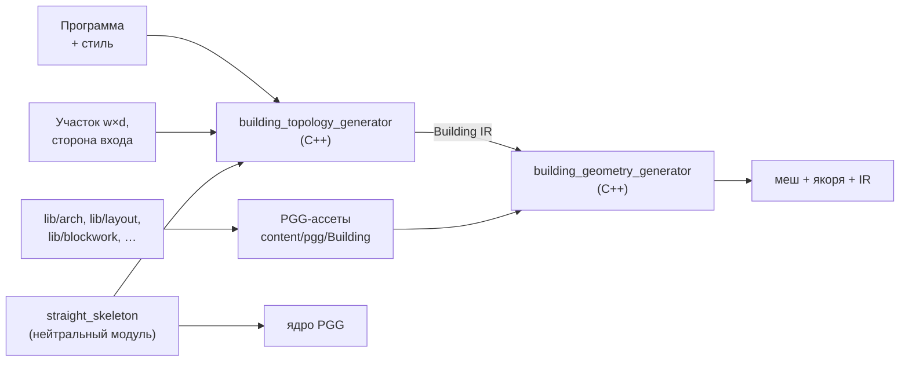
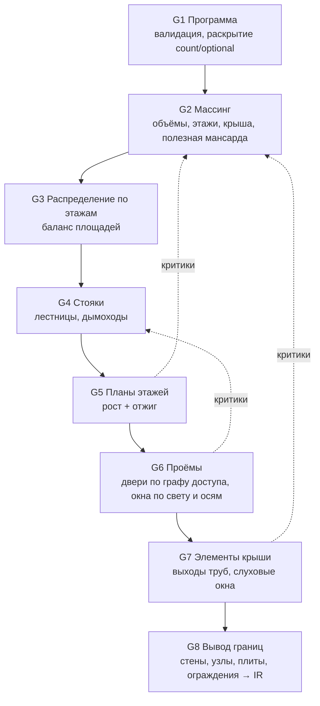
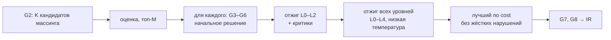

# BuildingGenerator — целостные здания с интерьером

**Статус:** черновик v0.3 (2026-10-15) · **Назначение:** требования и проект системы,
которая генерирует здание как единое целое — внутреннюю топологию (этажи, комнаты,
лестницы, дымоходы) и внешнюю форму (массинг, фасады, крыша) одновременно, с взаимным
влиянием одного на другое. Результат — здание, в которое можно войти и пройти по нему
в неразрывном игровом мире. Реализация — две библиотеки по образцу пары
`dungeon_topology_generator` → `dungeon_geometry_generator`. Алгоритмы стадий и петли
согласования (структуры данных, рост, отжиг, каскад, критики, псевдокод, пример
сходимости) — `algorithms.md` рядом.

История правок: **v0.2** — по итогам обзора: зафиксированы семантика контура объёма и
сетка этажа (§5.1–§5.2), метки `CORE`/`ROOF_VOID` (§6), примыкание крыши пристройки
(§7.2), нормировка термов (§8.2), нормы стремянки (§9.1), площадь мансарды и закрытый
чердак (§5.6), квантование чисел и коды функций в IR (§10), поля `pin` и `back_door`
в программе (§4.1), сводная таблица параметров (приложение A), решения по открытым
вопросам (§18). **v0.3** — подъём карниза отделён от кнеевой стенки, высота мансарды
считается до подшивки по худшей точке клетки (§5.6), примеры §5.6 и §9.2 пересчитаны от
внешней грани стен; ширина прохода в клетках зависит от классов стен (§5.2); контур и
высота крыши пристройки (§7.2); слуховые окна — производные в цикле (§7.7); `pin` —
отдельный вход (§4.5); детерминизм — в пределах платформы, переносится IR (N1); база
скелета крыши — с поправкой на свес (§7.2, §11.2).

---

## 0. Коротко

1. **Пространство первично, оболочка выводится.** Генератор оперирует не «коробкой с
   элементами», а пространственной моделью: этажи как сетки клеток, размеченных
   пространствами (комнаты, лестницы, дымоходы, улица). Стены, перекрытия, наружная
   оболочка и крыша — *границы* между пространствами, их выводят, а не рисуют. Поэтому
   внутреннее и внешнее не могут разойтись по построению.
2. **Связи интерьер ↔ экстерьер — явные и двусторонние** (§1.3): программа комнат
   растит массинг, контур плана задаёт крышу, крыша определяет полезную мансарду, очаг
   тянет дымоход к точке на крыше, фасадные оси двигают перегородки, тёмная комната в
   мансарде просит слуховое окно.
3. **Взаимное влияние — это петля согласования** (§8): одна функция стоимости с термами
   интерьера и экстерьера, ходы на всех уровнях (клетка плана → проём → стояк →
   распределение по этажам → массинг), каскадный пересчёт зависимых уровней и «критики»,
   которые превращают нарушения в направленные ходы вверх по иерархии.
4. **Вертикальные элементы — отдельные объекты, а не комнаты на каждом этаже.**
   Лестница и дымоход — сквозные «стояки» со своими ходами, которые меняют все этажи
   разом. Так межэтажная согласованность держится по построению — это главный урок
   Merrell et al. 2010, где межэтажная связь была основной причиной срывов.
5. **Топология — C++, геометрия — PGG.** Поиск планировки невыразим в `.pgg` (нет
   циклов `while`, рекурсии, списков, mesh-CSG). Геометрию строят PGG-ассеты по
   версионируемому Building IR — по образцу DGG: тела стен, облицовки, узлы, проёмы,
   юниты наполнения.

---

## 1. Что строим

Генератор жилых и ремесленных зданий малого поселения: дом, пекарня, таверна, мастерская.
1–3 этажа плюс мансарда, 3–14 комнат, площадь застройки до ~150 м². Эстетика — Stardew
Valley, Graveyard Keeper, европейская вернакулярная застройка XVI–XIX веков: фахверк,
камень, штукатурка, двускатные и вальмовые крыши, печные трубы.

Два класса задач:

| Класс | Что нужно | Решение |
|---|---|---|
| Фоновая застройка, вид сверху, стратегия | силуэт и характер | коробочные ассеты (есть) |
| Неразрывный мир от первого/третьего лица | войти, пройти, подняться по лестнице, увидеть очаг и трубу на крыше над ним | **этот документ** |

### 1.1. Главный принцип: пространство первично

Здание задаётся **пространственной моделью**: какие пространства есть на каждом этаже и
какие клетки сетки они занимают. Всё остальное выводится:

- стена — граница между клетками разных пространств одного этажа;
- наружная стена — граница между пространством здания и улицей;
- перекрытие — граница между этажами; проём в перекрытии — там, где стояк (лестница,
  дымоход) проходит насквозь;
- крыша — функция контура верхнего этажа (прямой скелет) и стиля; мансарда — пространство
  под крышей, полезная часть которого определяется высотой ската над полом.

Наружную форму нельзя «подправить», не изменив пространства. Обратное тоже верно: правка
пространства сразу меняет оболочку. Это и есть связность интерьера и экстерьера.

### 1.2. Второй принцип: дизайн задаёт смысл, генератор — раскладку

Как и в DGG, «осмысленность» — входные данные: **программа здания** (какие
комнаты, площади, этаж, приватность, связи, очаги) и стиль. Генератор отвечает на вопрос
«как это уложить в участок, этажи и крышу», а не «что тут должно быть».

### 1.3. Связи интерьера и экстерьера

Нормативный список связей, которые система обязана учитывать. Направление показывает,
какая сторона на какую влияет. Связь «↔» значит, что учитываются обе стороны: в функции
стоимости и в ходах.

| # | Связь | Направление | Механизм |
|---|---|---|---|
| C1 | суммарная площадь программы → площадь застройки, число этажей, пристройки | интерьер → экстерьер | подбор массинга (§7.2), критик «не влезает» (§8.4) |
| C2 | контур этажа → форма крыши | экстерьер → экстерьер | прямой скелет (`straight_skeleton`) |
| C3 | крыша → полезная площадь и форма мансарды | экстерьер → интерьер | высота подшивки над полом, подъём карниза, кнеевая стенка (§5.6) |
| C4 | мансардная комната требует света и высоты → слуховое окно, фронтонное окно, уклон | интерьер → экстерьер | критик «тёмная комната» (§8.4) |
| C5 | функция комнаты → число и размер окон | интерьер → экстерьер | правило света (§7.6) |
| C6 | сетка фасадных осей, симметрия главного фасада → положение перегородок | экстерьер → интерьер | терм регулярности фасада, ход «снап к простенку» |
| C7 | очаг → стояк дымохода → точка выхода и высота трубы над крышей | интерьер → экстерьер | §9.2 |
| C8 | конёк, ендовы, вальмы → предпочтительные места стояков | экстерьер → интерьер | терм высоты трубы, запрет ендов (§9.2) |
| C9 | лестница → проём в перекрытии; запас высоты над маршем → уклон крыши над лестницей в мансарде | ↔ | §9.1 |
| C10 | сторона входа (главный фасад `+Z`) → положение входной зоны, начала лестницы | экстерьер → интерьер | ограничение программы, терм глубины приватности |
| C11 | стены верхнего этажа опираются на стены нижнего | интерьер ↔ интерьер (по вертикали) | терм опирания, максимальный пролёт (§7.5) |
| C12 | крупный очаг (хлебная печь) → пристройка | интерьер → экстерьер | массинг с объёмом-пристройкой (§7.2) |
| C13 | крыша нижнего объёма перекрывает стену верхнего → окно уменьшается или исчезает | экстерьер → интерьер | проверка окна против плоскостей крыши (§7.6) |

---

## 2. Термины

| Термин | Смысл |
|---|---|
| **Программа** | вход дизайнера: список комнат (функция, площадь, этаж, зона приватности, очаг), связи между ними, ограничения здания. Аналог графа комнат DGG |
| **Пространство** | связная область одного этажа: комната, коридор, ядро стояка, улица |
| **Клетка** | единица сетки плана (по умолчанию 0.5 м); все размеры топологии — целые клетки |
| **Этаж (storey)** | горизонтальный слой здания с отметкой пола и высотой. Виды: `cellar`, `ground`, `upper`, `attic` |
| **Объём (volume)** | прямолинейный многоугольник в клетках с диапазоном этажей и своей крышей: основной корпус, крыло, пристройка |
| **Массинг** | набор объёмов здания с их крышами |
| **Стояк (core)** | вертикальный элемент, проходящий через несколько этажей и занимающий клетки на каждом: лестница, дымоход; позже — световой колодец, двусветный зал |
| **Лестница** | стояк: марш(и) на нижнем этаже, проём в перекрытии и площадка выхода на верхнем |
| **Очаг (hearth)** | источник дыма в комнате: камин, кухонный очаг, хлебная печь, горн |
| **Дымоход (chimney stack)** | стояк от очага (или нескольких очагов) до точки над крышей |
| **Граф доступа** | вершины — пространства и улица, рёбра — двери, проёмы, лестницы |
| **Сетка фасадных осей (bays)** | разбиение фасада на пролёты; окна центрируются на осях, перегородки встают на простенки |
| **Кнеевая стенка** | внутренняя низкая стенка мансарды по линии высоты `h_knee`, отсекающая непригодную зону под скатом (`ROOF_VOID`) |
| **Подъём карниза** (`eave_rise`) | высота плоскости ската на `outline` над полом мансарды; до неё поднимается наружная стена мансарды (в строительстве — высота мауэрлата). Не путать с кнеевой стенкой |
| **Building IR** | версионируемый JSON-выход топологии (`building-topology-generator-ir/0`): единственный вход геометрии |
| **Юнит** | часть здания, которую строит один прогон PGG: тело стены, облицовка, узел, перекрытие, лестница, дымоход, проём, крыша (семантика DGG) |
| **Оболочка (shell)** | только наружные юниты здания: LOD для дальнего вида; пиксельно совпадает с полным зданием снаружи |

---

## 3. Границы ответственности и место в стеке



| Кто | Отвечает за | Не отвечает за |
|---|---|---|
| **building_topology_generator** (BTG) | программа → массинг, этажи, стояки, планы, проёмы, элементы крыши; петля согласования; вывод границ; IR; проверки инвариантов топологии | метры геометрии деталей, кладку, терминалы, меш |
| **building_geometry_generator** (BGG) | IR → юниты → прогоны PGG → общий меш, якоря; кэш юнитов; режим оболочки; геометрические проверки | раскладку, программу |
| **PGG-ассеты здания** | геометрия юнита по его входу: стена с прорезанными проёмами, перекрытие с проёмами, марш, труба, крыша с отверстиями | соседние юниты, раскладку |
| **Ядро и `lib/` PGG** | домен-нейтральные механизмы: скелет, `clip`, раскладка, кладка | здания как домен (N3 DGG действует и здесь) |

### 3.1. Почему топология не на PGG

В языке нет `while`, рекурсии, списков и mesh-булевых операций (`docs/pgg/architecture_library_plan.md` §4,
§8). Поиск планировки — это стохастическая оптимизация с тысячами ходов и откатами,
невыразимая в нодовом графе. PGG остаётся тем, чем он силён: геометрией юнита по готовому
входу. Это то же решение, что принято для подземелий (раскладка Edgar в C++).

### 3.2. Почему не dungeon_topology_generator

Edgar раскладывает комнаты *без внешней границы*: он ищет непересекающиеся положения
шаблонов, но не заполняет заданный контур. Задача здания обратная: разбить контур этажа
на комнаты без остатка и согласовать это между этажами. Переиспользовать Edgar для планов
нельзя. Его подход к графу (стабильные id, сокеты дверей) — можно.

### 3.3. Не-цели v1

- Неортогональные планы (круглые башни, эркеры под углом, мельницы); мельница и колодец
  остаются коробочными ассетами.
- Подвалы, выступающие верхние этажи (jetty), уступы этажей; уводы дымохода; винтовые
  и забежные лестницы — всё это v2 (§16, B7).
- Мебель и декор интерьера (IR отдаёт семантику комнат и якоря очагов — достаточно для
  будущего слоя расстановки).
- Навмеш: IR несёт полы, лестницы и двери; построение навмеша — у движка.
- Рельеф под зданием: в v1 пол первого этажа на `y = 0`.
- Встраивание в генераторы поселений (деревня и др.): система самостоятельна, вход —
  программа и участок. Вход по форме совпадает с выходом размещения поселения (V6
  village_topology_generator: участок и ориентация фасада), поэтому будущая интеграция —
  адаптер входов, а не смена контракта.
- Интерактивный редактор планов.

---

## 4. Входы

### 4.1. Программа здания

JSON, `format: "building-program/0"`. Шаблоны программ по типам лежат в
`content/building/programs/<type>.json`.

```json
{
  "format": "building-program/0",
  "type": "house",
  "storeys": { "min": 1, "max": 2, "attic": "allowed" },
  "entrance": { "facade": "front", "into": ["lobby", "hall"] },
  "back_door": { "facade": "back", "into": ["hall"] },
  "rooms": [
    { "id": "lobby",   "fn": "lobby",    "area": [2, 5],   "storey": ["ground"], "zone": "public" },
    { "id": "hall",    "fn": "kitchen",  "area": [12, 18], "storey": ["ground"], "zone": "public",  "hearth": "fireplace" },
    { "id": "parlour", "fn": "living",   "area": [10, 16], "storey": ["ground"], "zone": "public",  "hearth": "fireplace" },
    { "id": "pantry",  "fn": "storage",  "area": [3, 6],   "storey": ["ground"], "zone": "service", "optional": true },
    { "id": "bed",     "fn": "bedroom",  "count": [1, 3],  "area": [8, 14], "storey": ["upper", "attic"], "zone": "private" }
  ],
  "links": [
    { "a": "hall",    "b": "pantry",  "kind": "door" },
    { "a": "lobby",   "b": "parlour", "kind": "door" },
    { "a": "pantry",  "b": "parlour", "kind": "no_door" }
  ],
  "style": { "roof": "gable", "pitch": [45, 55], "chimney": "central", "regularity": "loose" }
}
```

Поля комнаты: функция `fn` (словарь функций: `lobby, hall, kitchen, living, bedroom,
storage, shop, workshop, bakehouse, taproom, corridor, …`), площадь `[min, max]` м² чистой
площади, допустимые этажи (массив: `ground`, `upper`, `attic`), зона приватности
`public | service | private`, очаг, число экземпляров `count`, `optional`. Связи: `door`
(обязательная дверь), `near` (желательная смежность), `no_door` (запрет прямой двери),
`same_storey`.

Поля программы вне комнат: `h_ground` (м, опционально — поднимает высоту первого этажа,
§5.3; 0 = умолчание из параметров) и `style.proportion` (`[min, max]` отношения ширины
фасада к глубине, умолчание `[1.0, 2.0]`; G2 отсекает кандидатов вне диапазона).

Ссылки на комнаты (`links[].a/b`, `entrance.into`, `back_door.into`) — по `id` из
программы. Ссылка на комнату с `count` применяется ко всем её экземплярам; на конкретный
экземпляр ссылаются по id вида `bed.1`. `back_door` опциональна; `facade` — сторона
(`front` / `back` / `left` / `right`).

Функция комнаты задаёт умолчания: минимальную ширину, нужен ли свет (`habitable`),
допустимое число дверей, может ли туда вести вход.

Программа — переиспользуемый шаблон: в ней нет ничего, что относится к конкретному
экземпляру здания. Фиксация части решения — отдельный вход (§4.5).

### 4.2. Ограничения участка

Задаются при вызове (CLI или хост): габарит участка `w × d` (м), главный фасад `+Z`,
отступы от границ участка, максимальное число этажей. Площадь застройки считается по
внешней грани стен (контур объёма, §5.2) плюс свес крыши.

### 4.3. Параметры: два яруса

Как в DGG (§4.1 его требований), параметр принадлежит ровно одному ярусу:

| Ярус | Примеры | Правка перезапускает |
|---|---|---|
| **Топология** | размер клетки, высоты этажей, толщины стен по классам, нормы лестницы, мин. ширина двери и прохода, размер стояка дымохода, рост и радиус игрока | BTG → IR → геометрию |
| **Наполнение** | стили кладки и облицовки, терминалы окон и дверей, профиль карниза, палитра, детализация | только геометрию (IR заморожен) |

Отличие от DGG: **высота этажа — параметр топологии**, потому что от неё зависят длина
марша и проём в перекрытии (§9.1). По той же причине топологическими являются толщины
стен: они уменьшают чистые площади.

### 4.4. Параметры игрока

Числа проходимости выводятся из габарита персонажа, а не задаются вручную по отдельности:
`player_height` (1.8 м), `player_radius` (0.3 м), `headroom_margin` (0.2 м). Отсюда
минимальная высота прохода `h_walk = player_height + headroom_margin`, минимальная чистая
ширина двери и коридора, минимальная ширина марша. Это гарантирует «можно пройти» для
конкретной игры, а не по абстрактной норме.

### 4.5. Фиксация части решения (`pin`)

Режим «закрепить понравившееся, перегенерировать остальное» (§18). Фиксация относится к
экземпляру здания (участок, seed), а не к шаблону программы, поэтому это отдельный вход:
файл `--pin <json>` (`format: "building-pin/0"`, `{ "massing": {…}, "cores": […] }`) или
выборка из сохранённого IR: `--pin-from <ir.json> --pin massing,cores`.

- Закреплённый массинг не перебирается в G2, а проверяется и используется (недопустимый
  для участка или программы — ошибка с подсказкой); ходы L4 выключаются целиком.
- Закреплённые стояки не перебираются в G4 и не двигаются ходами L2. Ход L4, после
  которого закреплённый стояк становится недопустимым, отвергается до каскада.
- Координаты — в рамке здания (§5.1), в клетках и в метрах; расхождение между ними —
  ошибка (pin от другой сетки).

---

## 5. Семантика чисел (нормативно)

### 5.1. Оси и рамка здания

- Локальная рамка здания: метры, `+Y` вверх, план в XZ, главный фасад смотрит в `+Z`, начало координат — центр пятна застройки на отметке
  пола первого этажа (`y = 0`). Ширина участка `w` — вдоль X (по фасаду), глубина `d` — вдоль Z.
- Сетка: клетка `(i, j)` ↔ `x = x0 + i·s`, `z = z0 + j·s`, `s` — размер клетки. Сетка
  **одна на этаж на всё здание**: она покрывает bbox всех объёмов этажа, клетки вне
  объёмов — `OUTSIDE` (так над одноэтажной пристройкой на втором этаже оказывается
  улица, §6). Контуры —
  обход CCW при взгляде с `+Y` (как `lib/arch/plan` и DGG).

### 5.2. Стены

- Ось стены лежит на линии сетки. Толщина откладывается симметрично (семантика DGG §5.2).
- **Контур объёма (`outline` в IR) — внешняя грань наружных стен**: он отстаёт от крайних
  линий сетки на половину толщины наружной стены наружу. По `outline` считается скелет
  крыши (§7.2) и откладывается свес; по `outline` + свес проверяется вписывание в участок
  (§4.2, I8).
- Классы стен и толщины по умолчанию: наружная `0.45`, несущая внутренняя `0.30`,
  перегородка `0.12`, фронтонная мансардная — как наружная, кнеевая — `0.10`. Класс
  выводится (§7.8), а не задаётся.
- Общая стена двух пространств — одна, с одним владельцем; узлы-столбы в стыках; тело и
  облицовки разделены. Всё как в DGG §5.2: щелей и двойной геометрии нет по построению.
- Облицовка наружной стороны берёт стиль экстерьера, внутренней — стиль комнаты.
- Чистая ширина комнаты = клетки × `s` − половины толщин ограждающих стен.
- **Ширина прохода в клетках** (коридор, марш) зависит от классов стен по бокам:
  `n = ceil((w_pass + t_a/2 + t_b/2) / s)`, `w_pass = 2·player_radius + 0.2` (§4.4).
  С умолчаниями: 2 клетки между перегородками (1.0 − 0.12 = 0.88 м), 3 клетки, если хотя
  бы одна сторона наружная или несущая (у наружной стены 2 клетки дают
  1.0 − 0.225 − 0.06 = 0.715 м < 0.8). Класс стены окончательно известен только после
  вывода (§7.8), поэтому при построении он прогнозируется (`algorithms.md` §6.4), а I3
  проверяется по фактическим классам.

### 5.3. Этажи и отметки

- Этаж `k` занимает `y ∈ [y_k, y_k + h_k]`, где `h_k` — чистая высота. Над ним плита
  толщиной `t_k`; `y_{k+1} = y_k + h_k + t_k`. Межэтажная высота `H_k = h_k + t_k`.
- Умолчания: первый этаж `h = 2.8`, верхний `h = 2.6`, плита `0.25`. Таверне и мастерской
  программа поднимает высоту первого этажа полем `h_ground` (§4.1).
- Пол мансарды — верх плиты последнего полного этажа.

### 5.4. Проёмы

- Дверь: отрезок на стене, целое число клеток (обычно 2 клетки = 1.0 м по осям); чистая
  ширина ≥ `2·player_radius + 0.2`. Отступ от узла ≥ половина толщины примыкающей стены +
  рама (инвариант DGG §5.4).
- Двери внутри комнаты — ближе к углам (правило Alexander et al., принятое у Merrell):
  терм стоимости «расстояние двери до ближайшего угла».
- Окно: отрезок наружной стены, ширина и высота по функции комнаты, отметка подоконника
  (0.8–0.9 м). Площадь остекления жилой комнаты ≥ 1/8 площади пола (санитарная практика;
  параметр).
- Проём прорезается в теле стены и обеих облицовках по одному отрезку IR.

### 5.5. Лестница

- Подъём ступени `r ≤ r_max` (0.19), проступь `g ≥ g_min` (0.25), правило Блонделя
  `2r + g ∈ [0.60, 0.65]`.
- Число подъёмов `n = ceil(H / r_max)`, `r = H / n`; длина марша в плане `L = (n − 1)·g`
  (верхний подъём выходит на пол верхнего этажа).
- Запас высоты над линией носков ступеней ≥ `h_walk`. Ступень `i` (отметка носка `i·r`)
  требует проёма в плите над собой, если `H − t − i·r < h_walk`. Отсюда первая ступень под
  проёмом `i0 = floor((H − t − h_walk)/r) + 1`; длина проёма — от ступени `i0` до верха
  марша.
- Пример: `H = 3.05`, `t = 0.25`, `h_walk = 2.0` → `n = 17`, `r ≈ 0.179`, `g = 0.27`
  (Блондель 0.629), `L = 16 · 0.27 = 4.32` м прямым маршем; `i0 = floor(0.8/0.179) + 1 = 5`
  → проём над ступенями 5–17, ≈ 3.2 м.
- Нормы этого параграфа — для полноценных лестниц; у лестницы-стремянки в нежилую
  мансарду нормы свои (§9.1).

### 5.6. Мансарда

- Плоскости крыши (скелет, §7.2) проходят через `outline` на отметке
  `eave_y = y_attic + eave_rise` и задают **верх** кровли. Высота помещения меряется до
  **подшивки**: `h(p) = roof_y(p) − roof_t / cos(pitch(p)) − y_attic`, где `roof_t` —
  толщина кровельного пирога по нормали к скату (0.25 м), `pitch(p)` — уклон грани над `p`.
  Подшивка в геометрии строится на том же смещении (§11.2).
- Высота клетки — **минимум** `h` по клетке (углы; если клетку пересекает ендова — и
  точки ендовы на её границе), а не значение в центре: при клетке 0.5 м и уклоне 50°
  разница до ≈ 0.4 м (худший угол — по диагонали клетки), и проверка по центру
  пропустила бы удар головой (I2).
- Полезная зона — клетки с высотой ≥ `h_walk`; кнеевая стенка ставится по линии высоты
  `h_knee` (1.2 м), зона за ней — закрытый объём (`ROOF_VOID`, §6).
- Мансардная комната занимает клетки до кнеевой стенки, но её **чистая площадь считается
  только по клеткам полезной зоны** (`h ≥ h_walk`): именно она сравнивается с `area`
  программы и пишется в `area_net` IR (§10).
- Мансарда, которую программа не использует (нет комнат с `attic` среди допустимых
  этажей), пространством не становится: её клетки — `ROOF_VOID`, пол — плита последнего
  этажа, доступа нет.
- Мансарда, которую программа использует (хотя бы одна обязательная комната допускает
  `attic`), обязана вмещать наименьшую такую комнату: полезная площадь за вычетом
  резерва циркуляции ≥ её `area_min`. Это отсев уровня G2 (наряду с правилом выхода
  лестницы, §9.1): мансарда, неспособная принять комнату, отбрасывается в массинге,
  а не всплывает отказом роста на G5 — этаж без комнат не строится, и донорская
  переброска G3 всегда имеет легальную цель.
- Пример: глубина корпуса 7.0 м по осям (`outline` 7.45 м), уклон 50°, `eave_rise = 0.8`,
  `roof_t = 0.25` → на расстоянии `x` от внешней грани `h = 0.8 + 1.19x − 0.39`;
  `h ≥ 2.0` при `x ≥ 1.33` м, то есть с 1.11 м от оси наружной стены. Первая клетка, у
  которой и худшая точка дальше, начинается в 1.5 м от оси → полезная ширина
  7.0 − 2 · 1.5 = 4.0 м. При 55° — 5.0 м; при 50° и `eave_rise = 1.2` — тоже 5.0 м; без
  подъёма карниза — 3.0 м. Это пример связи C3: уклон и подъём карниза меняют то, что
  помещается в мансарду.
- Полезная ширина меняется **скачками** по клетке с каждой стороны (1 м на двускатной
  крыше): соседнее значение уклона может не изменить её вовсе, а следующее — добавить
  ~7 м² на корпус длиной 8 м. Ходы L4 по уклону поэтому прыгают по всему набору значений,
  а не только к соседнему (`algorithms.md` §9.3).

### 5.7. Дымоход

- Сечение стояка — целые клетки сетки плана: один канал — 1×1, два канала — 1×2.
- Высота трубы над кровлей (практическое правило, СП 7.13130): не менее 0.5 м над коньком,
  если труба ближе 1.5 м к коньку по горизонтали; не ниже конька при 1.5–3 м; не ниже линии,
  проведённой от конька вниз под 10° к горизонту, при > 3 м. Плюс минимум
  `h_above_roof` (0.5 м) над поверхностью ската в точке выхода.
- Выход трубы не ближе `valley_margin` (0.6 м) к ендове и вальмовому ребру.

### 5.8. Идентичность и случайность

- Комнаты, стены, стояки, проёмы адресуются стабильными id (из программы + детерминированное
  правило нумерации), не индексами.
- Один seed на здание. Свой PRNG и свои распределения, **не** `std::*_distribution`:
  выход стандартных распределений зависит от реализации библиотеки, а поток случайных
  чисел должен зависеть только от seed. Межплатформенного детерминизма IR это не даёт:
  поиск сравнивает числа, посчитанные через `exp` и `tan`, а libm разных платформ
  округляет их по-разному, и одно перевёрнутое сравнение даёт другое здание. Переносимый
  артефакт — сохранённый IR (N1, §10).

---

## 6. Пространственная модель

Центральная структура BTG. Из неё выводятся все остальные стадии и IR.

```text
Building
  volumes[]        прямолинейные контуры в клетках, диапазон этажей, крыша (вид, уклоны по рёбрам, eave_rise, roof_t, свес)
  storeys[]        вид, отметка, высота, плита
    grid           клетка -> space_id | OUTSIDE | VOID | CORE(id) | ROOF_VOID
  spaces[]         id, этаж, функция, зона, очаг?, клетки
  cores[]          стояки: вид, клетки на каждом этаже, параметры (лестница / дымоход)
  openings[]       двери, окна, проёмы (на рёбрах сетки)
  roof_elements[]  слуховые окна, выходы труб
```

Метки клеток: `space_id` — пространство; `OUTSIDE` — улица (в том числе над объёмами
меньшей этажности); `VOID` — проём перекрытия (над маршем лестницы); `CORE(id)` — клетка
стояка; `ROOF_VOID` — закрытый объём мансарды за кнеевой стенкой (§5.6).

Правила модели:

- **Стояк владеет клетками на всех своих этажах.** Клетки лестницы на нижнем этаже —
  марш, на верхнем — проём плиты (`VOID` над маршем) и площадка. Клетки дымохода на всех
  этажах от очага до мансарды — сплошное тело.
- **Ходы стояка атомарны:** сдвиг лестницы на клетку переносит марш, проём и площадку
  сразу. Межэтажное рассогласование, которое ломало оптимизацию у Merrell («лестница
  упирается в стену на втором этаже»), невозможно по построению.
- Клетка дымохода — не пространство: её граница с комнатой — не стена, а грань стояка
  (ассет дымохода строит эту грань). Поэтому выступ дымохода в комнату (грудь камина)
  получается без особых случаев.
- Граница клетки `VOID` (проём над маршем) на верхнем этаже — не стена, а ограждение
  (перила), если по другую сторону пол.
- Объёмы с разным числом этажей (двухэтажный корпус + одноэтажная пристройка) дают на
  верхнем этаже клетки `OUTSIDE` над пристройкой. Стена над крышей пристройки — наружная по
  выводу, окно в ней проверяется против плоскости крыши (C13).

---

## 7. Конвейер генерации

Стадии дают начальное решение; петля согласования (§8) его улучшает, может вернуться к
любой стадии и пересчитать зависимые. Алгоритм каждой стадии — `algorithms.md` §2–§7, §12.



### 7.1. G1 — программа

Загрузка и проверка (неизвестный ключ, тип, диапазон — ошибка с путём и подсказкой, как в
DGG R-P2). Раскрытие `count` в экземпляры с id `bed.0`, `bed.1`; опциональные комнаты
помечаются, их включение решает G2/G3. Сумма минимальных площадей + доля коммуникаций
(параметр, 10–15 %) даёт оценку требуемой чистой площади по этажам.

### 7.2. G2 — массинг

Вход: оценки площадей, участок, стиль. Выход: объёмы, число этажей, крыша.

- Кандидаты: прямоугольник; Г — **один объём с Г-образным контуром** (ендовы и вальмы
  даёт скелет, C2); корпус + пристройка как **два объёма** с разной этажностью (в том
  числе пристройка под хлебную печь, C12). T и П — v2.
- Габариты кратны клетке, пропорции в диапазоне стиля, вписаны в участок с отступами.
- Крыша каждого объёма — `straight_skeleton` по `outline` (внешняя грань стен, §5.2) с
  уклонами рёбер (фронтон — уклон 90°). Тот же код, что у билтина PGG: BTG и PGG получают
  одинаковые плоскости (§11.4). Ядро ведёт развёртку со смещённого на свес контура,
  поэтому базу опускают: `y0 = eave_y − overhang · tan(pitch)` — тогда плоскость проходит
  через `outline` на `eave_y`, как считает §5.6 (приём из `content/pgg/Mansion`). При
  разных уклонах рёбер одного `y0` на всех не хватит; в v1 per-edge уклоны — только
  фронтоны (90°, поправка не нужна), общий случай — режим ядра «якорь на базовом
  контуре», вне B0.
- Крыша пристройки, упирающейся в стену корпуса: ребро примыкания в контуре пристройки
  имеет уклон 90° (ската не образует); стык со стеной закрывается фартуком (§11.1), стена
  корпуса над крышей пристройки — наружная по выводу (§6), её окна проверяются против
  плоскости этой крыши (C13).
  - **Контур на ребре примыкания.** Своей наружной стены у пристройки там нет: на первом
    этаже это внутренняя стена между пристройкой и корпусом, выше — наружная стена
    корпуса. Поэтому ребро примыкания в `outline` пристройки лежит на внешней грани стены
    корпуса — линия сетки + `t_ext/2` в сторону пристройки, — а не на `t/2` наружу, как
    свободные рёбра.
  - **Вид крыши пристройки.** `shed` (односкатная): вертикальны ребро примыкания и оба
    боковых ребра, боковые стены — треугольные фронтоны. `hip`: вертикально только ребро
    примыкания, ската три.
  - **Высота.** Верх крыши пристройки на ребре примыкания по всей его длине ниже
    поверхности крыши корпуса над той же точкой (`roof_y` корпуса) на ≥ `apron_gap`
    (0.3 м, место под фартук). У карнизной стороны корпуса это «ниже карниза», у
    фронтонной — «ниже ската фронтона». Иначе крыши пересекаются, а пересечение двух
    скелетов v1 не строит; кандидат отсекается в G2.
- Полезная площадь мансарды — пересечение плана с зоной «высота ≥ `h_walk`» (§5.6).
- Оценка кандидата: соответствие площадей по этажам (C1), компактность, сложность крыши
  (число ендов), пропорции фасада. На следующие стадии уходят лучшие `M` кандидатов.
- Ни один кандидат не прошёл отсечения — ошибка «программа не влезает в участок» с
  числами (требуемая площадь программы vs площадь участка) и подсказкой, что ослабить
  (F1-стиль). Не зависание и не пустой результат.

### 7.3. G3 — распределение по этажам

Комнаты раскладываются по этажам с учётом допустимых этажей, зон (первый этаж — `public`
и `service`, верх — `private`) и баланса «требуемая / доступная площадь» каждого этажа.
Опциональные комнаты и `count` добираются, пока есть запас. Нехватка площади — запрос к G2
(критик §8.4). Этаж, оставшийся без комнат, получает донором наименьшую обязательную
комнату из тех, что допускают этот этаж и влезают в его чистую площадь за вычетом
резерва циркуляции (для мансарды площадь считается по полезной зоне, §5.6).

### 7.4. G4 — стояки

Ставятся **до** разбиения на комнаты, потому что это жёсткие межэтажные ограничения.

- Лестница (§9.1): по одной на каждую пару соседних этажей с комнатами; начало — в
  пространстве зоны `public`/коридоре, выход — в коридор или на площадку верхнего этажа.
  По умолчанию стопка: марши разных этажей — в одной шахте.
- Дымоходы (§9.2): по одному стояку на группу очагов; очаги, которые могут встать спиной к
  спине или друг над другом, объединяются.
- Кандидатов немного (положения вдоль стен с шагом в клетку, 2–4 типа): G4 перебирает
  их и оценивает по термам §8.2, лучшие уходят в G5.

### 7.5. G5 — планы этажей

Разбиение клеток этажа (за вычетом стояков) на пространства программы.

- **Инициализация — рост с ограничениями** (Lopes et al. 2010): зерна комнат ставятся с
  учётом зон и связей (входная зона — у входной двери на фасаде `+Z`), растут
  прямоугольниками, затем Г-формами, остатки клеток раздаются соседям.
- **Улучшение — отжиг** по ходам уровня L0 (§8.3) с функцией стоимости §8.2.
  Все этажи оптимизируются **совместно**: термы опирания стен (C11) и выравнивания осей
  связывают этажи.
- Коридор появляется, только если граф доступа без него не замыкается (терм доли
  коммуникаций).
- Максимальный пролёт: меньший размер комнаты без промежуточной опоры ≤ `span_max`
  (5–6 м, параметр); больше — терм штрафа (v2 — балка/столб как элемент).

### 7.6. G6 — проёмы

- **Двери** по графу доступа: обязательные связи `door`, затем дерево кратчайших путей от
  входа (Дейкстра) с ценой прохода сквозь пространство по его зоне — так приватные
  комнаты оказываются листьями (`algorithms.md` §7.1); затем не больше одной лишней петли.
  Положение — у угла (§5.4), не под маршем, не в зоне дымохода, не перед верхней ступенью.
- **Входная дверь** — на главном фасаде в пространство из `entrance.into`; задняя дверь —
  по программе.
- **Окна**: у каждой `habitable`-комнаты ≥ 1 окно на наружной стене; суммарная площадь по
  правилу §5.4; положение — на осях фасадной сетки (C6). Окна верхних этажей выравниваются
  по осям нижних; главный фасад при `regularity: strict` симметричен.
- Окно проверяется против плоскостей крыш других объёмов (C13): частично закрытое
  уменьшается до меньшего типа, закрытое — убирается, а комната без света становится
  нарушением для критика.

### 7.7. G7 — элементы крыши

- Выход каждой трубы: точка плана стояка → плоскость ската над ней → требуемая высота
  (§5.7). Проверка дистанции до ендов и вальм.
- Слуховые окна: для мансардной `habitable`-комнаты без фронтонной стены — dormer на
  скате над ней (ширина по окну, положение по оси комнаты); проверка, что dormer не
  пересекает трубу и рёбра.
- В основном цикле слуховые окна — **производные**, как окна (`algorithms.md` §7.2 п. 6):
  терм «свет» их засчитывает, терм «крыша» платит за каждое. После цикла G7 только
  уточняет их геометрию; нет допустимого места — нарушение «свет» и критик «тёмная
  комната» (§8.4).
- Фронтонные окна мансарды — окна в фронтонной стене (обычный проём G6).

### 7.8. G8 — вывод границ

По сетке каждого этажа:

- Каждое ребро сетки между клетками разных пространств → сегмент стены; соседние
  коллинеарные сегменты с той же парой сторон сливаются в стену.
- Класс: `exterior` (одна сторона — улица), `bearing` (наружная или есть стена на этом же
  ребре этажом выше/ниже), `partition` (остальное), `gable`, `knee` (мансарда). Рёбра у
  стояков-дымоходов и `VOID` стен не дают (см. §6).
- Узлы — в вершинах, где сходятся стены, по правилам DGG (владелец — наименьший id).
- Плиты: область перекрытия = клетки пола верхнего этажа минус `VOID` лестниц и клетки
  дымоходов; область раскладывается на максимальные прямоугольники (детерминированно) —
  PGG получает простые боксы, CSG не нужен.
- Фронтонные стены мансарды получают верхний профиль — плоскости крыши (PGG режет их
  `clip`).
- Ограждения: рёбра `VOID` на стороне пола.

---

## 8. Петля согласования

Здесь происходит итеративное взаимное влияние интерьера и экстерьера. Она построена так,
чтобы быть детерминированной, отлаживаемой и всегда давать лучший найденный результат в
пределах бюджета. Реализация (инкрементальная стоимость, приём ходов, расписание
температуры, каскад с тёплым стартом, псевдокод, пошаговый пример) — `algorithms.md`
§1, §8–§11, §13. Строго говоря, схема — не чистый отжиг, а iterated local search с
отжигом как внутренним оптимизатором: каскадные ходы L2–L4 с полировкой следствий ломают
детальный баланс (`algorithms.md` §9). Это осознанный выбор, а не упрощение.

### 8.1. Состояние

`S = (массинг, распределение по этажам, стояки, планы, проёмы, элементы крыши)` —
пространственная модель §6 целиком. Производные (крыша, полезная мансарда, граф доступа,
классы стен) пересчитываются из `S` при каждом изменении затронутого уровня. Проёмы и
слуховые окна в основном цикле тоже выводятся из плана, но с **памятью положений**:
пересчёт сохраняет прежнее положение, пока оно допустимо (`algorithms.md` §7). Память —
часть `S`: она входит в журнал отката и в сверку инкрементальной стоимости с полной.

### 8.2. Функция стоимости

`cost(S) = Σ w_i · c_i(S)`. Жёсткие термы — ограничения: решение с ненулевым жёстким
термом не выдаётся. Во время поиска они участвуют с большим весом, чтобы через
недопустимые состояния можно было проходить.

| Терм | Вид | Что меряет | Связь |
|---|---|---|---|
| доступность | жёсткий | каждое пространство достижимо от входа; оба конца каждой лестницы доступны | — |
| проходимость | жёсткий | двери, коридоры и марши ≥ габарита игрока; высота ≥ `h_walk` над всеми проходными клетками (включая марши и мансарду) | C3, C9 |
| программа | жёсткий | обязательные комнаты есть, на допустимых этажах; связи `door` / `no_door` соблюдены | — |
| участок | жёсткий | застройка со свесами в участке | C1 |
| дымоход | жёсткий | стояк непрерывен, не проходит через дверь, окно, марш, `VOID`; комната очага примыкает к своему стояку; выход трубы не у ендовы | C7, C8 |
| полнота программы | мягкий | недобор опциональных комнат и экземпляров `count` до максимума | C1 |
| площадь | мягкий | отклонение чистой площади от `[min, max]` | — |
| форма | мягкий | невыпуклость и число углов (для коридоров и лестниц ослаблен, как у Merrell) | — |
| смежность | мягкий | невыполненные `near` | — |
| приватность | мягкий | глубина `private`-комнат в графе доступа меньше порога | C10 |
| коммуникации | мягкий | доля коридоров в площади этажа | — |
| свет | мягкий | `habitable` без окна; недобор площади остекления | C4, C5, C13 |
| регулярность фасада | мягкий | окна вне осей, рассогласование осей по этажам, асимметрия при `strict` | C6 |
| опирание | мягкий | длина стен верхнего этажа без стены под ними; превышение `span_max` | C11 |
| высота трубы | мягкий | высота трубы над скатом сверх минимума (тянет к коньку) | C7, C8 |
| число стояков | мягкий | каждый дымоход сверх одного | C7 |
| крыша | мягкий | число ендов, слуховых окон, сложность контура | C2, C4 |
| компактность | мягкий | периметр / площадь массинга | C1 |

**Нормировка.** Каждый мягкий терм приводится к безразмерной шкале (делением на свой
референс: площадь — на `target_area` комнаты, опирание — на длину стен этажа, высота
трубы — на высоту конька, и т.д.; точные формы — `algorithms.md` §8.4). Без этого веса
стиля зависели бы от размера здания: дефицит площади квадратичен в метрах, а счётные
термы — нет.

Веса — параметры стиля порядка единицы: у «усадьбы» регулярность фасада весит больше, у
«хижины» меньше.

### 8.3. Ходы

| Уровень | Ходы | Каскад |
|---|---|---|
| L0 план | сдвинуть прямой отрезок стены между двумя пространствами на клетку; передать граничную клетку соседнему пространству; обменять метки двух комнат; слить/разделить опциональную комнату; прорезать коридор (составной ход, `algorithms.md` §6.4) | — |
| L1 проёмы | сдвинуть дверь или окно вдоль стены; перевесить дверь на другую общую стену | в основном цикле проёмы — производная плана с памятью положений (`algorithms.md` §7); L1 — только финальная полировка |
| L2 стояки | сдвинуть лестницу или дымоход на клетку; повернуть/отразить лестницу; сменить тип лестницы; объединить/разделить стояки; перенести очаг на другую стену комнаты | локальная починка планов затронутых этажей (клетки стояка отбираются у соседей, освободившиеся раздаются) |
| L3 этажи | перенести комнату на другой этаж | переинициализация планов двух этажей ростом с сохранением зёрен остальных комнат |
| L4 массинг | сдвинуть ребро объёма на клетку; добавить/убрать этаж, крыло, пристройку; сменить уклон, подъём карниза или вид крыши | пересчёт крыши и мансарды → G3 → G4 → G5 с тёплым стартом |

Частоты ходов убывают с уровнем (L0 — тысячи, L4 — единицы). Дорогие ходы принимаются
только после локальной доводки следствий: состояние после L4 сначала полируется короткой
серией L0–L2 и лишь потом сравнивается с исходным. Иначе любой ход массинга выглядел бы
проигрышным из-за ещё не перестроенного плана.

### 8.4. Критики — направленные ходы

Случайные ходы находят улучшения медленно. Критик смотрит на конкретное нарушение и
предлагает ход, который его устраняет. Это и есть механизм «интерьер просит экстерьер»
и обратно.

| Критик | Срабатывает на | Предлагает |
|---|---|---|
| «не влезает» | площадь этажа < требуемой (G3) | L4: удлинить корпус, добавить этаж или пристройку; L3: перенести комнату; убрать опциональную |
| «пусто» | запас площади > порога | L4: укоротить; L3: добавить экземпляр `count` |
| «недостижимо» | пространство вне графа доступа | L0: удлинить общую стену с достижимым соседом до длины двери; L0: прорезать коридор; L2: сдвинуть лестницу, отрезавшую комнату |
| «тёмная комната» | `habitable` без окна и без допустимого слухового окна | L0: дотянуть комнату до наружной стены или фронтона; L2: отодвинуть стояк, мешающий слуховому окну; L4: поднять уклон или подъём карниза |
| «труба высока» | высота трубы над скатом ≫ минимума | L2: сдвиг стояка к коньку; перенос очага на перегородку под коньком |
| «лестница душит» | проём лестницы режет комнату или нет запаса высоты в мансарде | L2: развернуть или сменить тип; L4: поднять карниз (`eave_rise`) или уклон |
| «висит стена» | стена верхнего этажа без опоры | L0 на верхнем или нижнем этаже: выровнять перегородки |
| «ось» | окно вне фасадной оси или перегородка на оси окна | L0: снап перегородки к простенку; L1: окно на ось |

Доля направленных ходов — параметр (по умолчанию 30 %). Все предложения критика
перечисляются в детерминированном порядке, выбор между ними — тем же PRNG.

### 8.5. Расписание и детерминизм



- Бюджет: итерации и время, отмена (по образцу `early_stop_*` / `request_cancel` у
  dungeon_topology_generator). Исчерпан бюджет с жёсткими нарушениями — диагностика
  «не собралось»: какие термы, какие пространства, какой критик пробовал что. Не зависание.
- Мультистарт: `R` независимых прогонов от отщеплённых seed'ов; выдаётся лучший.
- Детерминизм: порядок обхода фиксирован (индексы, `std::map`), свой PRNG (§5.8);
  гарантия — в пределах платформы и сборки, между платформами переносится сохранённый
  IR (N1).
- Наблюдаемость: на выходе — разбивка стоимости по термам, история принятых ходов L3–L4
  с причинами («добавлен этаж: программа 74 м² > полезная 52 м²»), снимки состояния после
  каждой стадии.

### 8.6. Почему стояки отдельно

Merrell et al. оптимизировали планы всех этажей совместно, но лестницы и двусветные
пространства были у них «комнатами» на каждом этаже. Результат: недосведённая доступность
примерно в 1 из 20 двухэтажных и в 1 из 5 трёхэтажных прогонов (их рис. 11 — лестница,
упёршаяся в стену). Здесь стояк — один объект с атомарными ходами (§6), поэтому этажи не
могут разойтись. Доступность обоих концов лестницы остаётся термом, но пространство,
которое её нарушает, локально (площадка), и критик «недостижимо» чинит его направленно.

---

## 9. Вертикальные элементы

### 9.1. Лестницы

**Типы v1.** Прямая (марш вдоль стены); Г-образная с площадкой; лестница-стремянка в
нежилую мансарду (крутая, ≤ 60°, малый след; только если наверху лишь `storage`).
v2: П-образная, забежная, винтовая (башни).

У стремянки нормы свои, §5.5 к ней не применяется: `r ≤ 0.23`, `g ≥ 0.15` (правило
Блонделя не действует); запас высоты `h_walk` над линией носков действует (I2).

**Размеры** — по §5.5; след в клетках вычисляется из `H` этажа, поэтому смена высоты этажа
меняет след лестницы (параметр топологии).

**Правила размещения:**

- нижний конец — в пространстве `public`/коридоре/входной зоне; верхний — в коридоре или
  на площадке, не внутри `private`-комнаты (если в программе нет `allow_through`);
- перед первой ступенью и после последней — свободная площадка ≥ ширины марша;
- двери не открываются на марш и не стоят под ним в зоне высоты < `h_walk`;
- под маршем — либо закрытый объём (кладовка, если программа разрешает), либо пустота;
  проходимость под маршем проверяется по высоте;
- проём в плите — по формуле §5.5; рёбра проёма со стороны пола верхнего этажа получают
  ограждение;
- выход в мансарду: проём должен попасть в зону, где высота над маршем ≥ `h_walk`, — иначе
  критик «лестница душит» (C9);
- 3+ этажей: марши — стопкой в одной шахте (терм предпочтения), смещение допускается
  ценой терма.

**Геометрия:** юнит лестницы получает тип, число подъёмов, `r`, `g`, ширину, направление,
площадку. Ассет строит ступени, тетиву или косоуры, перила. Проём в плите — не дырка в
меше, а отсутствие прямоугольников плиты (§7.8).

### 9.2. Дымоходы

Пример, о котором просили: камин в комнате тянет дымоход сквозь вышестоящие этажи и
крышу и определяет точку трубы на крыше.

**Очаги.** Программа помечает комнату очагом: `fireplace` (камин/очаг гостиной и кухни),
`oven` (хлебная печь: крупная, часто в пристройке), `forge` (горн кузницы). Тип задаёт
след у стены, вынос в комнату и число каналов.

**Архетипы размещения** (параметр стиля `chimney`):

| Архетип | Где стояк | Выход | Характер |
|---|---|---|---|
| `central` | на внутренней перегородке между двумя комнатами с очагами спиной к спине | у конька, минимальная высота трубы | тепло внутри дома; классический «дом с центральной трубой» |
| `gable` | в торцевой (фронтонной) наружной стене | у вершины фронтона; стояк виден на фасаде | английские и американские коттеджи; трубы парные на обоих торцах, только когда очаги есть у обоих торцов — ложных стояков без очага v1 не строит |
| `free` | любое место у стены | по правилу §5.7 | для пекарни и мастерской |

**Правила стояка:**

- стояк начинается на этаже очага и поднимается через все этажи выше, мансарду и крышу;
- на каждом этаже клетки стояка примыкают хотя бы к одной стене (в «гуще» комнаты он не
  стоит) и не пересекают двери, окна, марши и `VOID`;
- комнаты верхних этажей, через которые проходит стояк, теряют эти клетки; если у такой
  комнаты есть свой очаг, он садится на тот же стояк (второй канал — сечение 1×2);
- объединение очагов в один стояк поощряется термом «число стояков»; центральная труба на
  перегородке под коньком, обслуживающая две комнаты на двух этажах, — оптимум для
  `central`;
- выход: плоскость ската над центром стояка (по скелету), расстояние до конька, требуемая
  высота по §5.7; дистанция до ендов и вальм ≥ `valley_margin`;
- терм «высота трубы» штрафует превышение над минимумом: труба посреди ската торчит на
  2+ м — критик тянет её к коньку.

**Численный пример.** Корпус 8 × 7 м по осям (`outline` 8.45 × 7.45 м), первый этаж
2.8 м + плита 0.25 (пол мансарды 3.05), `eave_rise = 0.8` (карниз на 3.85 по `outline`),
двускатная крыша 50°, конёк вдоль X на `z = 0`. Отметки — верх кровли: конёк
`3.85 + 3.725 · tan 50° ≈ 8.29` м. Стояк на перегородке `x = 0` у конька (`z ≈ 0`):
ближе 1.5 м к коньку → верх трубы ≥ 8.79 м, над скатом ≈ 0.5 м. Тот же стояк, сдвинутый
к `z = −2.0`: 1.5–3 м → верх ≥ 8.29 м при отметке ската в этой точке
`3.85 + 1.725 · tan 50° ≈ 5.91` м → труба на 2.4 м над кровлей. Терм высоты трубы и критик возвращают стояк к коньку, а за ним сдвигается
перегородка между комнатами внизу. Так дымоход меняет планировку (C7 ↔ C8).

**Геометрия:**

- юнит очага — портал камина или печь у стены в комнате (терминал по типу);
- юнит стояка — сплошная колонна от пола этажа очага до верха трубы одним прогоном: грудь
  камина на этаже очага, сечение в стене или углу на верхних этажах, проход через мансарду,
  труба над кровлей с оголовком (`terminals_basic.chimney_stack` — уже есть);
- крыша: якоря черепицы внутри следа стояка плюс зазор удаляются (`delete` по предикату),
  панель ската режется вокруг стояка `clip`-плоскостями на 4 куска (как проёмы в
  `body_v2` у DGG); фартук — терминал по контуру;
- плиты: клетки стояка исключены из прямоугольников плиты.

**v2:** увод дымохода в мансарде (наклонный участок ≤ 30° от вертикали, чтобы вывести трубу
к коньку без сдвига очага), отдельные каналы печи и камина, искрогасители.

### 9.3. Прочие вертикали (v2)

Двусветный зал (таверна: зал на два этажа с галереей — `VOID` на верхнем этаже с
ограждением), световой колодец, люк в подвал, вентиляционные каналы (Shadows of Doubt
прокладывает их A* по пустотам между потолком и полом — тот же приём годится для
скрытых ходов). Модель §6 их уже допускает: это стояки с другим набором правил.

---

## 10. Building IR

JSON, `format: "building-topology-generator-ir/0"`, стабильный порядок ключей, все числа —
метры в рамке §5.1 (клетки — дополнительно, для отладки). Смена схемы — bump версии;
старая версия отклоняется с подсказкой (N7 DGG).

```text
{
  "format": "building-topology-generator-ir/0",
  "seed": …, "program": "house", "params": { cell, heights, thicknesses, player… },
  "storeys":  [ { "id", "kind", "y", "h", "slab_t" } ],
  "volumes":  [ { "id", "outline": [[x,z]…], "storeys": [k0,k1],
                  "roof": { "kind", "pitch_by_edge": […], "overhang", "eave_rise", "eave_y", "roof_t" } } ],
  "roof":     { "planes": […], "ridges": […], "valleys": […], "hips": […] },   // производное, из скелета
  "spaces":   [ { "id", "storey", "fn", "zone", "cells": […], "outline": […],
                  "area_net", "habitable", "hearth"? } ],
  "walls":    [ { "id", "storey", "a": [x,z], "b": [x,z], "class", "thickness", "owner",
                  "side_l": space|outside, "side_r": …, "h", "top_profile"?,
                  "openings": [ { "id", "kind": door|window, "s0", "s1", "y0", "y1", "type" } ] } ],
  "nodes":    [ { "id", "storey", "p": [x,z], "owner", "faces": … } ],
  "slabs":    [ { "storey_below", "storey_above", "rects": [ {x0,z0,x1,z1} ], "y", "t" } ],
  "railings": [ { "storey", "a", "b", "h" } ],
  "stairs":   [ { "id", "type", "from", "to", "start": [x,z], "dir", "width",
                  "risers", "rise", "going", "landing"?, "well": { rect } } ],
  "chimneys": [ { "id", "hearths": [ { "space", "kind", "wall", "s" } ],
                  "section": [w,d], "cells_by_storey": {…}, "top": [x,y,z], "roof_plane" } ],
  "dormers":  [ { "id", "plane", "at": [x,z], "w", "h", "window" } ],
  "access":   { "nodes": […], "edges": [ { "a", "b", "via": door|stair|open } ] },
  "anchors":  [ { "kind": entrance|hearth|bed_slot|light, "p", "dir", "space" } ],
  "report":   { "cost": { term: value… }, "moves": […] }
}
```

IR — артефакт (как F5 DGG): сохранённый IR наполняется без BTG, на другой машине и в другой
сборке. Это же точка ручной фиксации понравившегося здания.

Дополнительные правила записи:

- все числа с плавающей точкой квантуются до 1e-4 м при сериализации: шум последних
  разрядов не попадает в диффы IR (N6) и в fingerprint голденов (N1);
- строковые поля (`fn`, `zone`, `class`) дублируются int-кодами из `codes.pgg`
  (`fn_code`, …): строки — для чтения и отладки (N6), коды — для ассетов, потому что PGG
  строки не читает (§11.1);
- пол первого этажа (на `y = 0`) плитой не моделируется: это юнит `floors/finish` по
  комнатам (§11.1); `slabs[]` — только межэтажные перекрытия;
- `area_net` мансардной комнаты — по полезной зоне (§5.6).

---

## 11. Геометрия: building_geometry_generator

### 11.1. Юниты и слоты

Схема — DGG (§5.2, §6.4 его требований), чтобы переиспользовать опыт и, по возможности,
код наполнения.

| Юнит | Вход | Ассет (слот) |
|---|---|---|
| тело стены | сегмент, класс, толщина, высоты сторон, проёмы, верхний профиль (фронтон) | `walls/body_<class>` |
| облицовка | сторона стены, стиль (наружный/комнаты), проёмы | `walls/facing_<style>` |
| узел | точка, толщина, грани | `walls/node` |
| плита | прямоугольники, отметка, толщина; покрытие пола по комнатам | `floors/slab`, `floors/finish_<style>` |
| проём | дверь/окно: ширина, высота, тип, толщина стены | терминалы `lib/arch/terminals_*` |
| лестница | §9.1 | `stairs/<type>` |
| ограждение | отрезок, высота | `terminals_basic.rail_run` |
| очаг | тип, ширина, вынос | `hearths/<kind>` |
| дымоход | стояк целиком | `chimneys/stack` |
| крыша | контур объёма, уклоны рёбер, свес; отверстия труб и слуховых окон; рёбра примыкания к стенам других объёмов (уклон 90°, §7.2) | `roof/roof` над `lib/arch/roof` (`roof_wavefront`, `tile_anchors`); фартук примыкания — терминал |
| слуховое окно | плоскость, положение, размер | `terminals_basic.dormer_gable` |
| потолок | нижняя грань плиты или подшивка мансарды (скаты, смещённые вниз на `roof_t` по нормали, §11.2) | `ceilings/<style>` |

Ассеты лежат в `content/pgg/Building/` (с фикстурами входа, как `content/dgg/assets`:
каждый открывается сам в PggViewer). Коды функций, классов и стилей — int-константы в
общем `codes.pgg` (строки в полях PGG не читаются).

### 11.2. Что уже есть и переиспользуется

- `lib/arch/roof.roof_wavefront` + `tile_anchors` — крыша по любому прямолинейному
  контуру. Уклоны по рёбрам уже работают: обёртка передаёт в `straight_skeleton` точки
  контура вместе с `@pitch` (уклон исходящего ребра, 90° — фронтон), параметр `pitch` —
  только умолчание. Свес учитывается поправкой базы `y0` (§7.2).
- Подшивки мансарды в библиотеке нет: `roof.underside` зеркалит скаты под карнизом —
  это толщина кровли для коробочных зданий без интерьера, а не потолок под скатом. Нужен
  def, смещающий панели скатов вниз на `roof_t` по нормали; он входит в B0 (§16).
- `lib/arch/elements.chimney_rule` — правило конька (BTG считает то же самое и передаёт
  готовое значение; ассет не выводит его повторно — §4.3 DGG «производные — в одном месте»).
- `lib/arch/terminals_basic` — окно, дверь, труба, dormer, перила, карниз.
- DGG `walls/body_v2` — приём прорезки проёмов `clip`-плоскостями без CSG.
- `lib/blockwork`, `lib/masonry` — кладка с подрезкой по проёмам.

### 11.3. Ограничения ядра и обходы

| Ограничение | Обход |
|---|---|
| нет mesh-CSG | проёмы в стенах — `clip` на куски; проёмы в плитах — прямоугольники плиты из BTG; отверстие в скате — 4 куска `clip` + удаление якорей черепицы |
| `foreach`/`repeat` не кэшируются межпрогонно | кэш на уровне юнитов BGG по хешу входа (F8 DGG) |
| компланарные пары граней мерцают | правило DGG: зазоры/выносы ≥ 20 мм между плитой, облицовкой и узлом |
| неравномерный `@scale` запрещён | терминалы строятся под размер (контракт `lib/arch` §5.6) |

### 11.4. Одна крыша для топологии и геометрии

BTG должен знать плоскости крыши (мансарда, трубы, слуховые окна, окна под крышей
пристройки) ровно такими, какими их построит PGG. Решение: вынести
`src/libs/pgg/src/eval/straight_skeleton.{h,cpp}` в нейтральный модуль (например,
`src/libs/geom2d`; туда же — offset контура и разбиение области клеток на прямоугольники)
и использовать его из ядра PGG и из BTG. IR передаёт в PGG тот же контур и те же уклоны.
Совпадение плоскостей проверяется тестом (B0).

### 11.5. Оболочка и полный режим

- Каждая грань меша несёт `@zone ∈ {exterior, interior}` и, для интерьера, `@space_id`.
- Режим оболочки строит только юниты с наружными гранями (наружные облицовки, крыша,
  трубы, проёмы со стороны улицы, остекление «тёмным» вариантом терминала).
- Инвариант: наружные грани оболочки совпадают с наружными гранями полного здания (набор
  вершин группы `exterior` идентичен). Игра может переключать LOD без видимого скачка
  снаружи, а порталы для куллинга интерьера — двери и окна из IR.

---

## 12. Функциональные требования

| # | Требование | Критерий приёмки |
|---|---|---|
| **F1** | загрузка и проверка программы (§4.1) до вычислений | ошибка называет ключ, ожидание, факт, исправление |
| **F2** | массинг по программе и участку с крышей и мансардой (G2) | для программ 40–150 м² выбранный массинг вмещает программу в пределах её диапазонов и лежит в участке; отчёт объясняет выбор |
| **F3** | стояки: лестницы и дымоходы как сквозные объекты (§6, §9) | на любом seed стояк занимает согласованные клетки на всех этажах; сдвиг стояка не рассинхронизирует этажи (юнит-тест хода) |
| **F4** | планы этажей с дверями и окнами (G5–G6) | все жёсткие термы = 0 на эталонном наборе seed'ов (§14) |
| **F5** | петля согласования с ходами L0–L4 и критиками (§8) | на эталонном наборе полный цикл даёт меньшую суммарную стоимость, чем поэтапный без L3–L4, без роста жёстких нарушений; история ходов L3–L4 в отчёте |
| **F6** | элементы крыши: выходы труб по правилу, слуховые окна (G7) | правило §5.7 выполняется численно на всех трубах; dormer не пересекает трубы и рёбра |
| **F7** | вывод границ и IR (G8, §10) | каждое общее ребро — ровно одно тело стены и две облицовки; каждый стык — один узел; плита не перекрывает лестничный проём и стояк |
| **F8** | IR как артефакт | сохранённый IR наполняется без BTG |
| **F9** | наполнение по IR через PGG-ассеты (§11) | каждый юнит отдаёт меш; ассет, не подходящий слоту, отклоняется до прогона (R-A3 DGG) |
| **F10** | оболочка и полный режим (§11.5) | набор вершин группы `exterior` совпадает в двух режимах |
| **F11** | геометрические проверки (§14.2) | числами, без картинки |
| **F12** | машинная петля: CLI для всех шагов, ошибки в стиле PGG | агент проходит «программа → IR → OBJ» только через CLI |
| **F13** | наблюдаемость: разбивка стоимости, снимки стадий, планы этажей картинкой | SVG планов каждого этажа (пространства, стены по классам, стояки, проёмы, оси фасада) |

---

## 13. Нефункциональные требования

| # | Требование | Критерий |
|---|---|---|
| **N1** | детерминизм: одинаковые программа, участок, параметры, seed, платформа и сборка → побайтно тот же IR (свой PRNG, фиксированный порядок обхода, §5.8). Между платформами побайтное совпадение не гарантируется (libm); переносимый артефакт — сохранённый IR, который наполняется одинаково везде (F8) | голдены fingerprint IR на фиксированных seed'ах на эталонной платформе CI; `fill` сохранённого IR на всех платформах |
| **N2** | скорость: дом из 6–8 комнат в 2 этажа — ≤ 1 с в Release, ≤ 5 с в Debug; несколько зданий — параллельно по зданиям | бенчмарк-тест с порогом |
| **N3** | PGG домен-нейтрален: в ядро — только нейтральное (скелет в общем модуле, §11.4) | — |
| **N4** | без новых зависимостей: без MIQP- и SAT-солверов; стек монорепо | `vcpkg.json` не меняется |
| **N5** | лёгкое ядро: BTG и BGG без GUI | CLI собирается без оконной подсистемы |
| **N6** | читаемость: IR и программа — текст, стабильный порядок ключей | правка одного параметра даёт локальный дифф |
| **N7** | версионирование IR и программы; чужой `format` отклоняется с подсказкой | тест на старый формат |

---

## 14. Инварианты и проверки

### 14.1. Топология (по IR, без меша)

- I1. Граф доступа связен от входа; у каждой лестницы оба конца в нём.
- I2. Высота ≥ `h_walk` над каждой проходной клеткой: этажи, марши (по линии носков),
  мансарда (до подшивки, по худшей точке клетки, §5.6), под маршем, если там проход.
- I3. Чистая ширина дверей, коридоров, маршей ≥ габарита игрока.
- I4. Стояки непрерывны по этажам; клетки дымохода не пересекают двери, окна, марши, `VOID`.
- I5. Труба выполняет правило §5.7; выход не ближе `valley_margin` к ендове или вальме.
- I6. Каждая `habitable`-комната имеет окно (или dormer); окно не закрыто крышей другого
  объёма.
- I7. Обязательные комнаты и связи программы соблюдены.
- I8. Застройка со свесами — в участке; верхний этаж не выходит за нижний (v1).
- I9. Каждое общее ребро — одна стена с одним владельцем; каждый стык — один узел.
- I10. Разбиение этажей полное и однозначное: каждая клетка внутри объёмов принадлежит
  ровно одному пространству, стояку или `VOID`/`ROOF_VOID`; каждое пространство —
  4-связная область, в которой каждая клетка накрыта квадратом `m × m` клеток, целиком
  лежащим в пространстве, `m = ceil(min_dim / s)` (морфологическое открытие). Для
  прямоугольника это «меньшая сторона ≥ `min_dim`», для Г-формы — то же для каждого
  крыла; узкий «язык» в одну клетку не проходит.

### 14.2. Геометрия (по мешу, как F11 DGG)

- проём одинаков в теле стены и обеих облицовках;
- нет щелей и двойной геометрии между телами стен, узлами, облицовками, плитами;
- черепица не заходит в след трубы и слухового окна; труба выходит над скатом на
  расчётную высоту;
- ступени: подъём и проступь в допусках; проём плиты над маршем ≥ расчётного;
- фронтонная стена не торчит над плоскостью крыши.

---

## 15. Инструменты

- **CLI** `BuildingGeneratorCli` (по образцу DGG):
  - `generate --program <json> --w <m> --d <m> --seed <n> -o <dir>` → `ir.json`,
    `plans/storey_<k>.svg`, `report.txt`; фиксация части решения —
    `--pin <json>` или `--pin-from <ir.json> --pin massing,cores` (§4.5);
  - `fill <ir.json> [--shell] -o <dir>` → `building.obj`, `anchors.json`;
  - `check <ir.json>` — инварианты §14;
  - `--emit-pgg` — сцена `.pgg` для PggViewer с параметром разреза `cut_y` (`clip` по
    отметке: видно этаж сверху без вышележащих — главный способ смотреть интерьеры);
  - `--selftest` — программа → IR → OBJ без IO.
- **SVG планов** — основной отладочный вид: пространства цветом зоны, стены по классам,
  стояки, двери, окна, фасадные оси, проекция конька и ендов, выход труб.
- **Вьюер** — позже (v2): вкладки этажей, 3D с разрезом, тепловая карта термов стоимости
  по клеткам.
- **MCP** — после стабилизации CLI, как у DGG.

---

## 16. Этапы

| Этап | Объём | Приёмка |
|---|---|---|
| **B0. Замороженный IR и геометрия** | схема IR v0; вручную написанный IR дома (2 этажа + мансарда, Г-лестница, центральная труба на два очага); BGG с минимальными юнитами (стены с проёмами, узлы, плиты с проёмом, лестница, крыша, подшивка мансарды на `roof_t`, стояк, двери, окна); вынос скелета в нейтральный модуль (§11.4); `fill` в CLI | дом проходим: проверки §14.2 зелёные; плоскости крыши BTG и PGG совпадают (тест); разрез каждого этажа отрендерен; ассеты открываются сами |
| **B1. Программа и массинг** | F1, F2: загрузчик программ, шаблоны `house`/`bakery`/`tavern`, кандидаты массинга (▭, Г, + пристройка), этажи, крыша, полезная мансарда | на 3 программах × 5 участков массинг вмещает программу; отчёт объясняет выбор |
| **B2. План одного этажа** | G5 (рост + отжиг; комнаты — только прямоугольники, фаза L выключена, §18) и G6 для одноэтажного здания; граф доступа, двери, окна по свету и осям; SVG планов | 100 seed'ов × 3 программы: I1, I3, I6, I7 — 100 %; мягкие метрики в порогах; замер ходов/с с экстраполяцией на бюджет N2 |
| **B3. Этажи и лестницы** | G3, G4 (лестницы), совместная оптимизация этажей, Г-формы комнат (фаза L включена), опирание стен, проёмы плит, ограждения, мансарда с кнеевыми стенками и фронтонными окнами | I1–I3 — 100 % на 100 seed'ах для 2 этажей + мансарды; ни одной заблокированной лестницы; замер ходов/с в рамках N2 |
| **B4. Дымоходы** | очаги, стояки (`central`, `gable`, `free`), объединение, выход по правилу, отверстия в кровле, ассеты очага и стояка | I4, I5 — 100 %; численный тест примера §9.2; рендер трубы над коньком |
| **B5. Петля согласования целиком** | ходы L3–L4, критики, слуховые окна, регулярность фасада, веса стилей | F5: полный цикл лучше поэтапного по суммарной стоимости на эталонном наборе; бюджет N2 |
| **B6. Оболочка и экспорт** | LOD-оболочка, якоря, экспорт; программы пекарни (печь → пристройка → труба, C12) и таверны | F10; пекарня и таверна собираются на эталонном наборе seed'ов с I1–I10 = 100 % |
| **B7. v2** | подвал, jetty и уступы этажей, увод дымохода, П-образные, забежные и винтовые лестницы, Т/П-планы, двусветный зал, рельеф под зданием, якоря мебели, вьюер | по каждому пункту — отдельная приёмка |

Порядок «сначала замороженный IR и геометрия, потом генератор» повторяет D0/D1 DGG: он
проверяет контракт геометрии раньше, чем вкладываться в поиск, и даёт эталон, с которым
сравнивается сгенерированное.

---

## 17. Риски

- **Качество и время поиска.** Отжиг на сетке 0.5 м даёт сотни клеток на этаж — это мало,
  но L4-ходы с каскадом дороги. Смягчение: топ-M массингов, тёплый старт, критики, бюджет;
  бенчмарк в CI (N2); ранняя проверка скорости ходов уже на B2/B3 (§16), а не в B5.
- **Слишком много юнитов PGG.** Дом — сотни юнитов. Смягчение: кэш по
  хешу входа (F8 DGG), слияние облицовок стороны комнаты в один юнит (вопрос 1 DGG),
  параллелизм по зданиям.
- **«Сеточный» вид.** Все размеры кратны 0.5 м. Смягчение: в наполнении — нерегулярность
  деталей (кладка, наличники); сетка 0.25 м — открытый вопрос.
- **Веса термов.** Ручная настройка весов — источник хрупкости. Смягчение: эталонный набор
  программ с метриками, регресс по голденам стоимости, веса — в стиле, а не в коде.
- **Расхождение крыши BTG и PGG.** Закрывается общим модулем скелета (§11.4) и тестом B0.
- **Компланарность и мерцание** на стыках плиты, стены и облицовки. Правило зазоров DGG,
  геометрическая проверка.

---

## 18. Открытые вопросы и предварительные решения

Решения, принятые при обзоре v0.2, помечены «решено»; они действуют, пока метрики этапов
не покажут обратное.

1. **Решено.** Размер клетки: 0.5 м (по умолчанию). Вариант 0.25 м проверяется один раз
   на B2 по метрикам качества и времени — не угадыванием. 0.6 м (модуль фахверка)
   отклонён: конфликтует с числами проходимости §4.4.
2. **Решено.** B2 — только прямоугольники (фаза L роста выключена): меньше степеней
   свободы при отладке терма формы и правила «дверь у угла». Г-формы включаются в B3
   (§16).
3. **Решено.** Формат программы — JSON: единообразие с IR и проектами DGG,
   nlohmann-json уже в стеке (N4).
4. Общий «раннер юнитов» с DGG (`dungeon_geometry_generator_fill`): держать свою копию
   до стабилизации схемы юнитов (ориентировочно до B6), затем выносить в общую
   библиотеку отдельным рефакторингом.
5. **Решено.** Фиксация части решения — в v1: отдельный вход `pin` (§4.5), без UI.
   При модели §6 это недорого и нужно для итераций дизайна. В программу не встраивается:
   программа — шаблон, а pin относится к экземпляру (участок, seed).
6. **Решено.** Двери: направление открывания и зона распахивания — v2.
7. Мебель: отдельный генератор расстановки поверх IR (якоря, семантика комнат) — его
   требования писать отдельно.
8. **Решено.** Чердак без жилых комнат — закрытый объём `ROOF_VOID` без доступа (§5.6);
   проходимый чердак появляется, только если программа явно просит.
9. **Решено.** Межплатформенный детерминизм поиска не гарантируется (N1): своя `exp`,
   таблицы `tan` и запрет FMA-сжатия стоят дороже, чем дают, пока здания не генерируются
   на клиентах разных платформ из одного seed. Переносится сохранённый IR.

---

## 19. Референсы

**Совместная генерация планов и здания**

- Merrell, Schkufza, Koltun. *Computer-Generated Residential Building Layouts.* ACM TOG 29(6),
  SIGGRAPH Asia 2010. <http://vladlen.info/papers/architecture.pdf>. Программа → планы
  всех этажей стохастической оптимизацией (термы: доступность, размеры, этажи внутри
  нижних, форма) → 3D со скелетной крышей. Берём: функцию стоимости как основу §8.2,
  двери у углов, скелет для крыши, «этаж внутри нижнего». Не берём: байесовскую сеть по
  реальным данным (у нас программа — вход дизайнера), лестницы как комнаты на каждом этаже
  (§8.6). Явную оптимизацию экстерьера авторы оставили на будущее — это то, что
  добавляет этот проект (связи C4–C8, C13).
- Lopes, Tutenel, Smelik, de Kraker, Bidarra. *A Constrained Growth Method for Procedural
  Floor Plan Generation.* GAME-ON 2010.
  <https://graphics.tudelft.nl/Publications-new/2010/LTSDB10a/LTSDB10a.pdf>. Сетка, зоны,
  рост прямоугольниками → Г-формами, заполнение остатков, гарантия достижимости. Берём:
  инициализацию G5.
- ColePowered Games. *Shadows of Doubt DevBlog 13: Creating Procedural Interiors.*
  <https://colepowered.com/shadows-of-doubt-devblog-13-creating-procedural-interiors/>;
  *DevBlog 17: Ventilation Shafts.*
  <https://colepowered.com/shadows-of-doubt-devblog-17-ventilation-shafts/>. Игра, где
  каждая комната каждого здания исследуема: коридоры от входа, комнаты по важности со
  скорингом площади, формы и окон, правила смежности и числа дверей, «займ» площади у
  соседей; вентиляция — A* по пустотам. Берём: практические правила плана, скоринг окон,
  A* по пустотам для v2.

**Прочее**

- Müller et al. *Procedural Modeling of Buildings* (CGA), SIGGRAPH 2006 — фасадная
  грамматика; основа `lib/layout`/`lib/arch`; интерьер не порождает (комнаты — остатки).
- Aichholzer et al. 1995; Felkel & Obdržálek 1998 — прямой скелет (реализован в ядре PGG,
  A4 `architecture_library_plan.md`).
- Alexander et al. *A Pattern Language*, 1977 — градиент приватности, двери у углов, свет с
  двух сторон.
- Hillier & Hanson. *The Social Logic of Space*, 1984 — граф доступа, глубина пространств.
- Ching. *Architecture: Form, Space, and Order* — вертикальное членение, пролёты, оси.
- СП 7.13130 — высота дымовых труб относительно конька.

**Рассмотрено и не подошло**

- Выдавливание фасадной коробки с нарезкой интерьера (CGA-split): комнаты — остатки,
  лестницы и дымоходы не согласуются с фасадом.
- Squarified treemaps (Marson & Musse 2010): быстро и всегда заполняет, но плохо держит
  смежность и не связывает этажи; годится разве что как альтернативная инициализация.
- MIQP/SAT-постановки (Wu et al. 2018 и др.): качество высокое, но нужен солвер — тяжёлая
  зависимость (N4).
- WFC: локальная согласованность без глобальной семантики.
- Edgar (dungeon_topology_generator): нет внешней границы (§3.2).

---

## Приложение A. Сводная таблица параметров

Все параметры, разбросанные по тексту, — в одном месте. Ярус: **T** — топология (правка
перезапускает BTG → IR → геометрию), **С** — стиль (веса и диапазоны стиля),
**П** — поиск (только поведение петли), **Н** — наполнение (только геометрия, §4.3).

| Параметр | Умолчание | Ярус | Где |
|---|---|---|---|
| `cell` — размер клетки | 0.5 м | T | §5.1 |
| `h_ground`, `h_upper`, `slab_t` | 2.8 / 2.6 / 0.25 м | T | §5.3 |
| толщины стен: exterior / bearing / partition / knee | 0.45 / 0.30 / 0.12 / 0.10 м | T | §5.2 |
| `player_height`, `player_radius`, `headroom_margin` | 1.8 / 0.3 / 0.2 м → `h_walk` 2.0 м | T | §4.4 |
| дверь: ширина проёма, мин. чистая | 2 клетки; ≥ `w_pass` = 2·radius + 0.2 = 0.8 м | T | §5.4 |
| ширина коридора и марша в клетках | выводится из классов стен: 2 между перегородками, 3 у наружной или несущей | T | §5.2, algorithms §6.4 |
| отметка подоконника | 0.8–0.9 м | T | §5.4 |
| `glass_ratio` — остекление жилой комнаты | ≥ 1/8 площади пола | T | §5.4 |
| лестница: `r_max`, `g_min`, Блондель | 0.19 / 0.25 м / [0.60, 0.65] | T | §5.5 |
| стремянка: `r_max`, `g_min`, угол | 0.23 / 0.15 м / ≤ 60° | T | §9.1 |
| `h_knee` — линия кнеевой стенки | 1.2 м | T | §5.6 |
| `eave_rise` — подъём карниза, кандидаты в G2 | {0, 0.4, 0.8, 1.2} м | T | §5.6, algorithms §3 |
| `roof_t` — толщина кровельного пирога по нормали | 0.25 м | T | §5.6 |
| `apron_gap` — зазор крыши пристройки под крышей корпуса | 0.3 м | T | §7.2 |
| дымоход: `h_above_roof`, `valley_margin`, зоны конька | 0.5 / 0.6 м; 1.5 и 3.0 м | T | §5.7 |
| `span_max` — пролёт без опоры | 5–6 м | T | §7.5 |
| доля коммуникаций в оценке площади | 10–15 % | T | §7.1 |
| κ — оценка перегородок в G2 | доля брутто, калибровать на B1 | T | algorithms §3 |
| `bay_target` — целевой пролёт фасадной оси | 2.5 м, по стилю | С | algorithms §7.2 |
| `d_min` — минимальная глубина `private` в графе доступа | 2 | С | §8.2, algorithms §8.4 |
| `share_max` — доля коридоров без штрафа | 0.15 | С | §8.2, algorithms §8.4 |
| свес крыши | по стилю | С | §11.1; входит в вписывание в участок (I8) и C13, поэтому не наполнение |
| `regularity` | loose / strict | С | §4.1 |
| `chimney` — архетип дымохода | central / gable / free | С | §9.2 |
| уклоны крыши, пропорции фасада | диапазоны стиля | С | §4.1, §7.2 |
| веса термов `w_i` | O(1) после нормировки, в стиле | С | §8.2 |
| `M`, `K_c`, `R` — ширина мультистарта | 3 / 4 / 4 | П | algorithms §3, §5, §11 |
| `K_rect` — прямоугольники до перебора крыльев; `K_s` — кандидаты лестниц и дымоходов | 8 / 8 | П | algorithms §3, §5 |
| `N_stall` — ходов без улучшения до подогрева | 10 % бюджета прогона | П | algorithms §8.2 |
| `B1`, `B2` — бюджеты отжига | 20 000/этаж, 50 000/здание | П | algorithms §11 |
| `q` — доля ходов от критиков | 0.3 | П | algorithms §8.3 |
| вероятности уровней L0/L2/L3/L4 | 0.85 / 0.12 / 0.02 / 0.01 | П | algorithms §8.3 |
| смесь ходов L0: передача / сдвиг стены / обмен / слияние | 0.40 / 0.40 / 0.15 / 0.05; в B2 — 0 / 0.80 / 0.20 / 0 | П | algorithms §8.1 |
| калибровка T0, расписание, подогрев | 200 пробных ходов, p = 0.5; T_end = 0.01·T0; 0.3·T0 один раз | П | algorithms §8.2 |
| `s_L4` — масштаб температуры для L4 | ≈ 5 | П | algorithms §9.3 |
| полировка каскада L2 / L3 / L4 | 200 / 500 / 2000 ходов | П | algorithms §9 |
| `w_hard` — фазы веса жёстких термов | w0 · {1, 10, 100} по третям бюджета B1; в B2 — сразу w0 · 100 | П | algorithms §8.2, §11 |
| `T0` второго отжига | 0.3 · калибровочной | П | algorithms §11 |
| зазоры против мерцания | ≥ 20 мм | Н | §11.3 |
